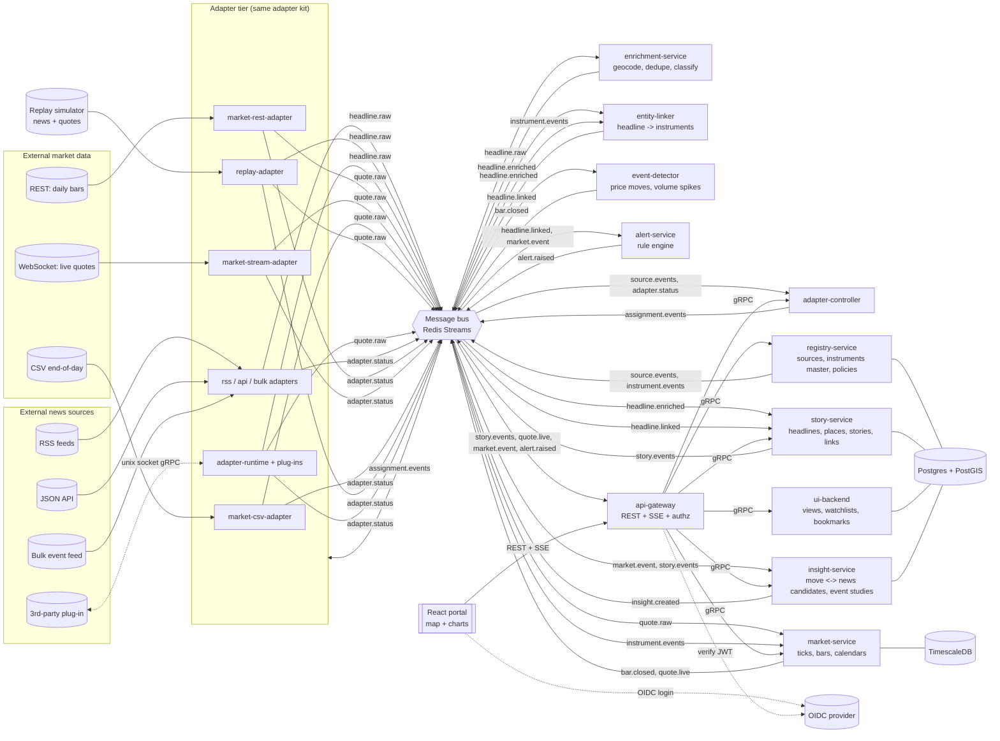

# NewsAtlas — A Learning Project for Event-Driven Go Backends + React Portals

> Build a distributed system that **collects news headlines and market prices
> from many sources through pluggable adapters, geo-tags and links the news to
> companies/instruments, and visualises both on a live map and on price charts
> - then connects the two by explaining *"why did this stock move?"***. The goal
> is twofold: (1) learn how a multi-service Go backend, a message bus, adapters,
> a UI backend, an API gateway and a React portal fit together, and (2) end with
> a tool you will actually use every day.

Everything here runs on your laptop with Docker, and can later be deployed to
**any** cloud or a single cheap VM. No proprietary registries, CI systems or
company infrastructure are needed.

> **Disclaimer.** This is an educational/analysis tool. It is not financial
> advice, it does not place trades, and correlation between a headline and a
> price move is *not* causation. Check each data provider's terms before storing
> or redistributing their data (personal, non-redistributed use is the safe
> default).

> **Companion Textbook & Engineering Knowledge Base**:
> - 📖 **Textbook**: *Go in Practice (Second Edition)* by Nathan Kozyra (Manning Publications, 2024) — [Local PDF](downloads/Go_in_Practice_Second_Edition.pdf)
> - 📝 **Study Notes & Code Recipes**: [writings/go_in_practice_notes.md](writings/go_in_practice_notes.md) (All 13 chapters + 10 Cardinal Rules of Go)

---

## Table of contents

1. [How to use this document](#1-how-to-use-this-document)
2. [What you will build](#2-what-you-will-build) (incl. product roadmap)
3. [What you will learn](#3-what-you-will-learn)
4. [Architecture](#4-architecture)
5. [Tech stack](#5-tech-stack)
6. [Repository layout](#6-repository-layout)
7. [Core contracts](#7-core-contracts) (domain model, events, topics, gRPC, REST)
8. [Phases](#8-phases) (the actual curriculum — see also [USER_STORIES.md](USER_STORIES.md) and [stories/](stories/))
9. [Data sources](#9-data-sources)
10. [Testing strategy](#10-testing-strategy)
11. [Observability](#11-observability)
12. [Security](#12-security)
13. [Deployment (cloud-neutral)](#13-deployment-cloud-neutral)
14. [Stretch goals](#14-stretch-goals)
15. [Progress checklist](#15-progress-checklist)
16. [Appendix: code skeletons](#16-appendix-code-skeletons)
17. [Appendix: glossary and reading list](#17-appendix-glossary-and-reading-list)

---

## 1. How to use this document

- Work **phase by phase** (section 8). Each phase has: *goal, concepts,
  tasks, deliverables, "done when", exercises, reflection questions*.
- **Do not skip the "done when" tests.** They are how you know you actually
  understood the concept rather than copied it.
- Build **thin vertical slices first**. The document is organised so that you
  have something *usable* at the end of each product version (v1-v4, see
  section 2.3) rather than only at the very end.
- Write a short `notes/phase-N.md` after each phase: what surprised you, what
  you would change. This is the most valuable learning artifact.
- Time estimate (rough, for someone comfortable with Go and React but new to
  this architecture): **v1 ~140 h, v2 +~70 h, v3 +~45 h, v4 +~20 h**
  (~275 h to the end of v4, i.e. roughly 9 months at 7-8 h/week), plus ~90 h of
  hardening (phases 10, 11, 18-20). Each product version is a usable stopping
  point, so you can stop - or reorder - whenever the tool is useful enough.
  The per-phase estimates below are the source of truth; adjust after your first
  two phases.

| Product version | Phases | Result you can use |
|---|---|---|
| **v1 - News map** | 0-7, 13, 15 (map part) | RSS headlines on a live map (walking skeleton) |
| **v2 - Market dashboard** | 8, 9, 14, 15 (chart part) | Watchlist with live/EOD prices and charts beside the news map |
| **v3 - News <-> price linking** | 12, 16 | Headlines linked to tickers; "why did it move?" panel |
| **v4 - Insights and alerts** | 17 + stretch | Alerts, daily briefing, event-study statistics |
| Hardening | 10, 11, 18-20 | More adapters, plug-ins, ops, cloud |

Suggested build order (not strictly numeric): 0, 1, 2, 3, 4, 5, 6, 7 ->
**Milestone A** -> 13 -> 15 (map) -> **v1** -> 8, 9 -> 15 (charts) -> **v2** ->
12, 16 -> **v3** -> 17 -> **v4** -> 10, 11, 18, 19, 20.

> **Shortcut for v1:** before `ui-backend` (Phase 14) exists, let the gateway
> call `story-service.GetInBBox` and cluster in the browser (Supercluster, ideally
> in a web worker). The server-side cluster read model in Phase 14 is then a
> measurable *optimisation* you add in v2 - which is a better way to learn why
> read models exist than building one up front.

---

## 2. What you will build

**NewsAtlas** continuously pulls headlines from external "news sources" (RSS
feeds, a JSON API, a bulk event feed, a replay/simulator source, and a
third-party plug-in adapter) **and market prices** from "market data sources"
(a free REST API for daily bars, a streaming WebSocket for live crypto/FX
quotes, a CSV end-of-day feed, a replay simulator). It de-duplicates and geo-tags
headlines, links them to companies/instruments, groups related ones into
*stories*, detects unusual price moves, and shows everything on:

- an interactive **map** of where news is happening, and
- **price charts** with news markers on the timeline,

so you can answer *"what was going on when this moved?"* and, later,
*"which kinds of news usually move this stock?"*.

### 2.1 User-visible features

News (v1):

- Map with clustered headline markers, live updates (no page refresh).
- Click a marker -> headline list with source, time, category, link.
- Filters: time range, category, source, language, text search.
- Saved map views and bookmarked headlines (per user).

Markets (v2):

- **Watchlists** of instruments (stocks, ETFs, crypto, FX, indices).
- Instrument page: candlestick/line chart (1m/5m/1h/1D), volume, % change,
  52-week range, compare-to-index overlay.
- Live price ticks via the same SSE stream as headlines.
- Map layer: colour a country/region by its market index move (optional).

Linking (v3):

- Each headline shows **linked instruments** (`AAPL`, `TSLA`, `BTC`...) with a
  confidence score and an explanation ("matched company name 'Apple' + alias").
- On the chart, news appear as **flags on the timeline**; hover highlights the
  marker on the map and vice versa.
- **Move events**: the system detects "AAPL -2.8% in 15 min on 3x volume" and
  attaches the **candidate news** published in the preceding window, ranked by
  relevance. The UI shows it as "Why did it move?".

Insights (v4):

- Alerts: "breaking news cluster in a region" and "watchlist instrument has an
  unusual move (with/without news)".
- Daily briefing: top movers in your watchlist + their linked news.
- Event study view: average price reaction (e.g. +1h, +1d) after headlines of a
  category for an instrument, with sample size and confidence interval - and a
  clear warning when the sample is too small.

### 2.2 Operator-visible features

- Health/readiness endpoints, metrics, traces.
- Adapters can crash and sources get re-assigned automatically.
- Everything is event-driven; services can be scaled independently.
- Data-quality dashboards: stale feeds, gaps in bars, duplicate ratio.

### 2.3 Product roadmap (what is "useful" at each stop)

| Version | You can use it for | Main new concepts |
|---|---|---|
| **v1 News map** | Watching world news geographically | Adapters, bus, enrichment, PostGIS, SSE, React + MapLibre |
| **v2 Market dashboard** | Replacing a browser tab of charts for your watchlist | Time-series storage, bar aggregation, streaming adapters, chart UI |
| **v3 Linking** | Quickly seeing the news behind a move | Entity linking, event detection, time-window joins, ranking |
| **v4 Insights** | Daily briefing, alerts, simple statistics | Rule engine, scheduled tasks, event-study methodology, honest statistics |

### 2.4 Out of scope (on purpose)

No order placement, no brokerage integration, no "buy/sell" predictions.
Backtesting and sentiment models are stretch goals, with explicit warnings about
look-ahead bias and overfitting (see section 14).

---

## 3. What you will learn

| Area | Concrete skills |
|---|---|
| Go service architecture | Boot/lifecycle framework, graceful shutdown, readiness gating, `internal/` layering, dependency inversion |
| Domain-driven design lite | Domain objects, repository interfaces, domain events, read models |
| Messaging | Streams, consumer groups, ack/redelivery, idempotency, DLQ, ordering, back-pressure |
| gRPC and REST | Proto design, interceptors, error mapping, OpenAPI-first REST, DTO mappers |
| Adapter pattern at scale | Adapter framework, source discovery, polling schedulers, backoff, circuit breakers, plug-in adapters over IPC |
| Controller / reconciler pattern | Desired vs actual state, leader election / distributed locks, rebalancing |
| Persistence | Postgres + PostGIS, **TimescaleDB hypertables and continuous aggregates**, ORM code generation (ent), migrations, caching, retention janitors |
| **Time-series and market data** | OHLCV bars, tick->bar aggregation with watermarks, out-of-order/late data, market calendars and time zones, corporate actions (splits), exact decimal arithmetic |
| **Text -> entities** | Entity linking (company name/alias/ticker -> instrument), ambiguity handling, confidence scoring, precision/recall evaluation |
| **Event detection and joins** | Rolling statistics (z-score, volatility), event windows, time-window joins between two streams, ranking, honest statistics (event studies, look-ahead bias) |
| API gateway / BFF | Auth, RBAC, aggregation, pagination, SSE/WebSocket fan-out |
| Frontend | React + TypeScript, map **and financial chart** rendering, state management, generated API clients, web workers, i18n, tests |
| Operations | Docker, Compose, Kubernetes/Helm, metrics, tracing, chaos testing, CI |

### Architectural patterns you will meet

| Pattern | Where you will use it |
|---|---|
| Adapter | One adapter per news source type, all behind one interface |
| Plug-in over IPC | External adapter process talking gRPC over a Unix socket |
| Controller / reconciler | `adapter-controller` assigns sources to adapter instances |
| Publish/subscribe + consumer groups | All inter-service async communication |
| CQRS-style read model | `ui-backend` keeps its own view-optimised tables fed by events |
| API gateway / BFF | `api-gateway` is the only thing the browser talks to |
| Repository | Domain layer defines interfaces, `ent` implements them |
| Cache + janitor | In-memory caches kept fresh by events, TTL/retention sweepers |
| Circuit breaker, retry, backoff | Every outbound call to a flaky source |
| Command/task bus | Long-running jobs (backfill, re-geocode) as tasks with subtasks |
| Rule engine | Alert rules evaluated against a stream of enriched headlines **and market events** |
| Streaming aggregation | Ticks -> 1m bars -> 5m/1h/1D bars with event-time watermarks |
| Stream join (time-window) | Attach candidate headlines to a price-move event |
| Late-arriving data / idempotent upsert | Bars and headlines corrected after the fact |

---

## 4. Architecture

### 4.1 Big picture



### 4.2 Service catalog

| Service | Responsibility | Talks to | Owns data? |
|---|---|---|---|
| `registry-service` | CRUD for **sources** (news *and* market), **instrument master** (symbol, exchange, currency, aliases, ISIN-like id), collection policies, credential *references* | gRPC server, publishes `source.events`, `instrument.events` | Yes (Postgres `registry`) |
| `adapter-controller` | Decides which adapter instance polls/streams which source; detects dead adapters; rebalances | Consumes `source.events`, `adapter.status`; publishes `assignment.events`; gRPC to registry | Soft (in-memory + Redis lock) |
| News adapters: `rss-adapter`, `api-adapter`, `bulk-adapter` | Poll one source *type*, normalise to `RawHeadline` | Consume `assignment.events`; publish `headline.raw`, `adapter.status` | No |
| Market adapters: `market-rest-adapter`, `market-stream-adapter`, `market-csv-adapter` | Fetch bars/quotes, normalise to `RawQuote` / `RawBar`; stream adapters hold a long-lived connection | Same adapter kit; publish `quote.raw`, `adapter.status` | No |
| `replay-adapter` | Deterministic **simulator** for news *and* quotes (fixtures, bursts, late data) | Same contracts | No |
| `adapter-runtime` | Host process for **out-of-tree** plug-in adapters (gRPC over Unix socket) - e.g. a vendor-specific market feed | Same bus contracts as built-in adapters | No |
| `enrichment-service` | Geocode, normalise URL, dedupe, classify, detect language | Consumes `headline.raw`; publishes `headline.enriched` | Small (gazetteer, dedupe index) |
| `entity-linker` | Link a headline to instruments: ticker/name/alias matching, disambiguation, confidence + explanation | Consumes `headline.enriched`, `instrument.events`; publishes `headline.linked` | Small (alias index, rebuildable) |
| `story-service` | Canonical headline store, places, story clustering, headline<->instrument links, spatial/time queries | Consumes `headline.enriched`, `headline.linked`; gRPC + publishes `story.events` | Yes (Postgres + PostGIS) |
| `market-service` | Tick/quote ingestion, **bar aggregation** (1m->5m->1h->1D), trading calendars, adjusted prices, latest-quote cache, history queries | Consumes `quote.raw`; publishes `bar.closed`, `quote.live`; gRPC | Yes (TimescaleDB) |
| `event-detector` | Detects abnormal price/volume behaviour per instrument (rolling z-score, gap, volume spike); stateless-ish with warm-up from history | Consumes `bar.closed`; publishes `market.event` | Small (rolling state, rebuildable) |
| `insight-service` | Joins `market.event` with candidate headlines in a time window and ranks them; computes event-study statistics; stores "Why did it move?" records | Consumes `market.event`, `story.events`; gRPC; publishes `insight.created` | Yes (Postgres) |
| `alert-service` | Rule engine (spatial/time windows on news, thresholds on market events); scheduled tasks (daily briefing) | Consumes `headline.linked`, `market.event`; publishes `alert.raised` | Yes (rules) |
| `ui-backend` | UI-specific data: saved views, **watchlists**, bookmarks, prefs, search/lazy-load, clustering for the map | Consumes `story.events`, `alert.raised`; gRPC | Yes (Postgres `ui`) |
| `api-gateway` | Public REST + SSE; authn/authz; maps REST<->gRPC; aggregation | gRPC to all backends; consumes bus for live fan-out | No |
| `health-checker` (optional) | Aggregates readiness of all services | HTTP probes | No |
| `portal` | React single-page app (map + charts) | Only `api-gateway` + OIDC | No |

> **You do not need all of these on day one.** v1 uses: registry, controller,
> rss-adapter, enrichment, story, gateway, portal. Each later service is added
> *without changing the producers* - that is the payoff of the event-driven
> design (for instance `entity-linker` simply subscribes to an existing stream).

### 4.3 Why these boundaries? (study this)

- **Adapters never talk to the database.** They only know "my sources" (from
  assignment events) and "the bus". This keeps adapters trivially horizontally
  scalable and replaceable.
- **`registry-service` is the single source of truth for configuration;**
  everything else learns about changes via events and caches them.
- **`story-service` owns facts** (headlines/places). **`ui-backend` owns
  preferences and presentation.** Never mix them: deleting a user must not touch
  headlines; reprocessing headlines must not touch bookmarks.
- **Only `api-gateway` is exposed to browsers.** Services never trust the
  browser; the gateway validates tokens, checks permissions, and maps DTOs.
- **Sync (gRPC) for queries and commands that need an answer; async (bus) for
  facts and notifications.** If you can't decide, ask: *"does the caller need
  the answer now?"*
- **Market data is a different workload from news.** High volume, strict
  ordering per instrument, numeric correctness, time-zone/calendar rules, and
  range queries -> it gets its own store (TimescaleDB) and its own service
  (`market-service`). News is lower volume, text-heavy and spatial -> PostGIS.
  Do not force both into one database "because it's simpler".
- **Linking is a separate, replaceable stage.** `entity-linker` is its own
  consumer so you can improve (or A/B test) the matching algorithm and
  *reprocess history* without touching adapters or the story store.
- **Detection and explanation are separate.** `event-detector` only says *"this
  moved abnormally"* (a fact about prices). `insight-service` says *"here are
  candidate reasons"* (a ranked hypothesis). Keep facts and hypotheses apart so
  you can change the ranking without recomputing events.

### 4.4 Request/data flows to be able to explain on a whiteboard

**Flow A - Add a source and see headlines**

1. Admin `POST /api/v1/sources` -> gateway -> `registry-service` (gRPC).
2. Registry writes DB, publishes `source.events {type: created}`.
3. Controller consumes it, picks an adapter instance (matching `source.type`),
   publishes `assignment.events {source_id -> adapter_id}`.
4. That adapter instance starts a poller for the source.
5. Adapter fetches, normalises, publishes `headline.raw` per item.
6. Enrichment consumes, geocodes, dedupes, publishes `headline.enriched`.
7. Story-service stores it and publishes `story.events {headline.added}`.
8. Gateway fans out via SSE; portal draws a marker.

**Flow B - Adapter crash**

1. Adapter stops sending `adapter.status` heartbeats.
2. Controller marks it dead after *N* missed beats, re-publishes assignments for
   its sources to surviving instances.
3. No headline is lost; duplicates are suppressed by idempotent dedupe.

**Flow C - Map pan/zoom**

1. Portal calls `GET /api/v1/map/clusters?bbox=...&zoom=...&from=...&to=...`.
2. Gateway -> `ui-backend` (gRPC) -> reads PostGIS-backed read model.
3. Response is a list of clusters/points; the portal renders it.

**Flow D - From tick to chart**

1. `market-stream-adapter` holds a WebSocket subscription for the instruments
   assigned to it; publishes `quote.raw {instrument, price, size, ts_exchange}`.
2. `market-service` consumes (group, keyed by instrument -> ordered), validates
   (reject negative/zero, absurd jumps flagged not dropped), updates the
   **latest quote cache**, and folds the tick into the open 1-minute bar.
3. When the watermark passes the minute boundary (+ allowed lateness) the bar is
   **closed**, upserted into TimescaleDB, and `bar.closed` is published.
   `quote.live` is published (throttled) for the UI.
4. Continuous aggregates / a rollup task derive 5m, 1h, 1D bars.
5. Gateway pushes `quote.live` over SSE; chart updates the last candle.

**Flow E - Headline gets linked to a company**

1. `headline.enriched` arrives at `entity-linker`.
2. It matches candidate mentions against the alias index (ticker, company name,
   product/brand aliases), disambiguates using context (category, source
   country, co-mentioned entities) and emits `headline.linked
   {headline_id, links:[{instrument, score, why}]}`.
3. `story-service` stores the links; the portal can show tickers on the
   headline and flags on the chart.

**Flow F - "Why did it move?"**

1. `bar.closed` -> `event-detector` computes the return and compares it with the
   instrument's rolling volatility; if abnormal, publishes `market.event
   {instrument, window, return, z, volume_ratio}`.
2. `insight-service` queries story-service for headlines **linked to that
   instrument (or its sector/country) within [t-Δ1, t+Δ2]** and ranks them
   (recency, link score, source reliability, story size, category).
3. It stores an `Insight {event_id, candidates[], method_version}` and publishes
   `insight.created`.
4. Portal shows the move on the chart with the ranked candidate headlines and
   their positions on the map.

> Flow F is where beginners get tricked: a headline published *after* the move
> can still be shown (it may be explaining it), but a statistic computed from
> it must never be used as if it *predicted* the move. Section 8, Phase 16
> covers this properly.

---

## 5. Tech stack

Pick the **bold** defaults. Alternatives are for variation exercises.

| Concern | Default | Alternatives (swap later as an exercise) |
|---|---|---|
| Language (backend) | **Go 1.22+** | - |
| Inter-service sync | **gRPC + protobuf** (`buf` for codegen/lint) | Connect-RPC |
| Public API | **REST + OpenAPI 3** (`oapi-codegen` or `ogen`) | GraphQL |
| Message bus | **Redis Streams** (consumer groups) | **NATS JetStream**, Kafka/Redpanda |
| Database (news, config) | **PostgreSQL 16 + PostGIS** | SQLite for Phase 3 only |
| Database (market time series) | **TimescaleDB** (Postgres extension: hypertables, continuous aggregates, compression) | QuestDB, ClickHouse, plain Postgres + partitioning |
| Money/price arithmetic | **Exact decimals** (`shopspring/decimal` in Go; integer-scaled or string in transport; never `float64` for stored prices/volumes in money terms) | `int64` minor units + scale |
| Market data transport | HTTP polling + **WebSocket client** (`coder/websocket` or `gorilla/websocket`) | SSE feeds, FIX (stretch) |
| Statistics helpers | `gonum` (rolling stats, regression) | hand-written Welford online mean/variance |
| ORM / schema | **`ent`** (code-gen) | `sqlc`, GORM |
| Migrations | **`goose`** or `atlas` | golang-migrate |
| Caching | In-process + Redis | Ristretto |
| Auth | **Keycloak (OIDC)** | Zitadel, Authentik, Auth0 free tier |
| Secrets | **Env + Docker secrets**, later **OpenBao/Vault** | Cloud secret manager |
| Frontend | **React 18 + TypeScript + Vite** | SolidJS, Vue |
| Map | **MapLibre GL JS** | Leaflet, deck.gl |
| Financial charts | **TradingView `lightweight-charts`** (candles, volume, markers) | uPlot (fast line charts), ECharts, visx |
| UI state | **TanStack Query + Zustand** (or Redux Toolkit) | - |
| UI tests | **Vitest/Jest + React Testing Library + Playwright** | Cypress |
| API client | Generated from OpenAPI (`openapi-typescript` + `openapi-fetch`) | orval |
| Build orchestration | **`Taskfile.yml`** (or `Makefile`) | just |
| CI | **GitHub Actions** (or any) | GitLab CI, Woodpecker |
| Containers | **Docker + Compose**, then **k3d/kind + Helm** | Podman |
| Observability | **Prometheus + Grafana + OpenTelemetry + Loki/Tempo** | Jaeger, Datadog free |
| Load testing | **k6** | vegeta |

> Pin every image/library version in a `versions.md` or in Compose/go.mod, and
> check the latest releases when you start. Versions drift quickly.

### Market data providers (pick 1-2; verify limits and terms yourself)

| Need | Free-tier style options | Notes |
|---|---|---|
| Live crypto quotes (WebSocket, often no API key for public streams) | Public exchange streams (e.g. Binance, Coinbase, Kraken public WS) | Best way to learn streaming adapters at zero cost |
| Daily/intraday stock bars (REST) | Alpha Vantage, Finnhub, Twelve Data, Polygon free tiers, Tiingo | Strict rate limits -> perfect for practising limiter + backoff |
| End-of-day files | Stooq daily CSV, exchange/ETF issuer CSVs | Good for the CSV adapter and backfills |
| FX reference rates | ECB daily reference rates (XML/CSV) | Tiny, reliable, excellent for tests |
| Macro series | FRED (free API key) | Optional macro overlay |
| Company master data | SEC `company_tickers.json` (US), exchange listings, Wikipedia/Wikidata aliases | For the instrument master and alias index |
| Offline / testing | Your own `replay-adapter` fixtures | Always available; deterministic |

Unofficial scraping endpoints can break or violate terms - prefer documented
APIs. **Never commit API keys**; store them as secrets and reference them from
the source via `credential_ref`.

### Map tiles

Don't hammer the public OpenStreetMap tile servers (usage policy). Use one of:
a free-tier tile provider, **OpenFreeMap**, or self-hosted **Protomaps PMTiles**
(a single file you can serve from object storage). Verify current terms before
you choose.

---

## 6. Repository layout

One Go module, many binaries - simple, and it mirrors how a large backend
monorepo is typically organised.

```text
newsatlas/
├── Taskfile.yml                  # task lint | test | build | up | down | gen
├── go.work / go.mod              # root module "example.com/newsatlas"
├── buf.yaml / buf.gen.yaml
├── proto/                        # .proto contracts (source of truth)
│   ├── registry/v1/registry.proto
│   ├── story/v1/story.proto
│   ├── market/v1/market.proto
│   ├── insight/v1/insight.proto
│   ├── ui/v1/ui.proto
│   ├── controller/v1/controller.proto
│   └── adapterplugin/v1/plugin.proto   # for out-of-tree adapters
├── api/
│   └── openapi.yaml              # public REST contract (source of truth)
├── cmd/                          # one tiny main.go per binary
│   ├── registry-service/main.go
│   ├── adapter-controller/main.go
│   ├── rss-adapter/main.go
│   ├── api-adapter/main.go
│   ├── bulk-adapter/main.go
│   ├── market-rest-adapter/main.go
│   ├── market-stream-adapter/main.go
│   ├── market-csv-adapter/main.go
│   ├── replay-adapter/main.go
│   ├── adapter-runtime/main.go
│   ├── enrichment-service/main.go
│   ├── entity-linker/main.go
│   ├── story-service/main.go
│   ├── market-service/main.go
│   ├── event-detector/main.go
│   ├── insight-service/main.go
│   ├── alert-service/main.go
│   ├── ui-backend/main.go
│   └── api-gateway/main.go
├── internal/
│   ├── common/                   # shared building blocks (the "platform")
│   │   ├── boot/                 # lifecycle framework (Phase 1)
│   │   ├── config/               # env/file config loader
│   │   ├── logger/               # slog setup, request-id, redaction
│   │   ├── mbus/                 # message bus abstraction (Phase 2)
│   │   │   ├── mb/               #   interfaces + factory
│   │   │   ├── redis/            #   Redis Streams impl
│   │   │   └── memory/           #   in-memory impl for tests
│   │   ├── events/               # event envelope + typed payloads
│   │   ├── grpcx/                # server/client helpers, interceptors
│   │   ├── restx/                # http server helpers, middleware, errors
│   │   ├── auth/                 # JWT verify, roles, permission checks
│   │   ├── db/                   # pgx pool, tx helper, health
│   │   ├── cache/                # generic cache + janitor
│   │   ├── dlock/                # distributed lock (Redis)
│   │   ├── resilience/           # retry, backoff, circuit breaker
│   │   ├── workerpool/
│   │   ├── tasks/                # command/task bus (Phase 17)
│   │   ├── health/               # liveness/readiness registry
│   │   └── testkit/              # testcontainers, fakes, golden helpers
│   ├── adapterkit/               # ADAPTER FRAMEWORK (Phase 4)
│   │   ├── core/                 #   Adapter, SourceRunner, scheduler, cache
│   │   ├── mbus/                 #   assignment/settings consumers
│   │   ├── settings/
│   │   └── status/               #   typed adapter errors + codes
│   ├── rss-adapter/              # each service has the SAME layout:
│   ├── registry-service/         #   config/ domain/ ent/ service/ grpc/ rest/ common/
│   ├── story-service/
│   ├── market-service/           #   adds bars/ (aggregator), calendar/, adjust/
│   ├── entity-linker/            #   adds aliasindex/, matcher/, disambiguate/
│   ├── event-detector/           #   adds detectors/ (zscore, gap, volume)
│   ├── insight-service/          #   adds ranking/, eventstudy/
│   ├── enrichment-service/
│   ├── alert-service/
│   ├── ui-backend/
│   ├── api-gateway/
│   └── adapter-controller/
├── plugins/
│   └── example-adapter/          # SEPARATE go.mod - proves the plug-in contract
├── portal/                       # React app: map + charts (Phase 15)
│   ├── src/{api,auth,components,scenes,hooks,store,services,workers,routes,i18n}
│   │       scenes/{map,instrument,watchlist,moves,sources,adapters,alerts,briefing}
│   └── ...
├── deploy/
│   ├── compose/docker-compose.yml
│   ├── docker/                   # Dockerfiles (multi-stage)
│   └── helm/newsatlas/           # umbrella chart + per-service subcharts
├── tools/
│   ├── new-service/              # generator for the standard service skeleton
│   ├── gazetteer-import/         # loads GeoNames into Postgres
│   ├── instrument-import/        # loads instrument master + aliases (tickers, names)
│   ├── backfill/                 # historical bars / headlines backfill CLI
│   ├── labeling/                 # tiny CLI/web page to hand-label links for evaluation
│   └── load/                     # k6 scripts
├── docs/
│   ├── adr/                      # architecture decision records
│   └── notes/                    # your per-phase notes
└── .github/workflows/ci.yml
```

### The standard per-service layout (memorise this)

```text
internal/<service>/
├── config/     # service config struct + loader; registered with boot
├── domain/     # entities, value objects, repository INTERFACES, domain events
├── ent/        # schema/, entgen/ (generated), repository/ (implements domain ifaces)
├── service/    # use-cases / application logic; consumes domain + calls repos
├── grpc/       # gRPC handlers (thin): validate -> service -> map DTOs
├── rest/       # (only if service exposes HTTP) handlers + mappers
├── mbus/       # bus consumers/producers specific to the service
├── common/     # enums/types shared inside the service
└── mocks/      # generated mocks for interfaces
```

**Rule of thumb:** dependencies point *inward*: `grpc/rest -> service -> domain`.
`domain` imports nothing from the other folders. `ent/repository` imports
`domain` (to implement it).

---

## 7. Core contracts

Define these **before** you write services. They are the spine of the system.

### 7.1 Domain model

```text
Source          id, name, kind (news|market), type (rss|api|bulk|replay|plugin|
                market_rest|market_stream|market_csv), url, enabled,
                poll_interval, tags[], credential_ref, language_hint,
                default_country, created_at, updated_at

AdapterInstance id, type, version, started_at, last_seen_at, capacity, state

Assignment      source_id, adapter_id, epoch, assigned_at

RawHeadline     source_id, external_id, title, summary, url, published_at,
                fetched_at, lang?, raw_geo? (lat/lon/country if source provides)

Headline        id (uuid), canonical_url, title, summary, published_at, source_id,
                category, lang, place_id?, point (PostGIS), confidence,
                story_id?, dedupe_key

Place           id, name, country_code, admin1, point, population, bbox?, aliases[]

Story           id, title, headline_count, first_seen, last_seen, centroid,
                category

AlertRule       id, name, expr, window, cooldown, enabled
Alert           id, rule_id, raised_at, area (geometry), headline_ids[], severity

SavedView       id, user_id, name, bbox, zoom, filters(json)
Bookmark        id, user_id, headline_id, note, created_at

--- market domain -------------------------------------------------------------
Instrument      id, symbol, exchange_mic, asset_class (equity|etf|crypto|fx|index),
                currency, name, country, sector?, isin?, active_from, active_to?,
                aliases[]  (company names, brands, common nicknames)

TradingCalendar exchange_mic, timezone, sessions (open/close per weekday),
                holidays[], half_days[]

RawQuote        source_id, instrument_ref (provider symbol), price (decimal string),
                size?, bid?, ask?, ts_exchange, ts_received, seq?
RawBar          source_id, instrument_ref, interval, open, high, low, close,
                volume, ts_open, adjusted? (bool)

Bar             instrument_id, interval, ts_open (UTC), open, high, low, close,
                volume, trades?, vwap?, is_final, revision   -- PK(instrument_id, interval, ts_open)
CorporateAction instrument_id, type (split|dividend|symbol_change), ex_date, ratio/amount

HeadlineLink    headline_id, instrument_id, score (0-1), method (ticker|name|alias|
                context), why (text), linker_version

MarketEvent     id, instrument_id, kind (return_spike|volume_spike|gap|volatility),
                window_start, window_end, ret (decimal), zscore, volume_ratio,
                detector_version, detected_at
Insight         id, market_event_id, candidates[{headline_id, rank, score, features}],
                method_version, created_at

Watchlist       id, user_id, name, instrument_ids[]
```

Modelling rules worth writing an ADR about:

- **Time:** store every timestamp in UTC; keep the exchange time zone on the
  calendar, not on each row. Daily bars are labelled by *exchange-local trading
  date*, not by UTC midnight.
- **Money:** exact decimals or scaled integers; never `float64` in storage or
  across service boundaries (transport prices as strings).
- **Identity:** a provider's symbol (`AAPL`, `BTCUSDT`) is *not* your instrument
  id. Keep a `provider_symbol -> instrument_id` mapping per source.
- **Revisions:** bars can be corrected later (`revision`, `is_final`); upserts
  must be idempotent and newer revisions win.

### 7.2 Event envelope (one envelope for everything on the bus)

```json
{
  "id": "01J...ULID",
  "type": "headline.raw.v1",
  "source": "rss-adapter/rss-1",
  "time": "2025-01-31T10:00:00Z",
  "trace_id": "4bf92f3577b34da6a3ce929d0e0e4736",
  "key": "source-id-or-entity-id",
  "schema": 1,
  "data": { }
}
```

Rules:

- `id` is globally unique -> consumers use it for **idempotency**.
- `key` is the *ordering key* (e.g. `source_id`): all events of one key must be
  processed in order. (Think about how you will guarantee that on Redis Streams
  or Kafka partitions - Phase 2.)
- Evolve schemas by **adding** fields; bump `schema` for breaking changes.

### 7.3 Topics / streams

| Stream | Producer | Consumers (group) | Key |
|---|---|---|---|
| `source.events` | registry | controller, ui-backend | source_id |
| `instrument.events` | registry | entity-linker, market-service (both rebuild caches; broadcast) | instrument_id |
| `assignment.events` | controller | all adapters | adapter_id |
| `adapter.status` | adapters | controller, ui-backend | adapter_id |
| `headline.raw` | adapters | enrichment (`enrichment`) | source_id |
| `headline.enriched` | enrichment | story (`story`), entity-linker (`linker`) | dedupe_key |
| `headline.linked` | entity-linker | story (`story-links`), alert (`alert`) | headline_id |
| `quote.raw` | market adapters | market-service (`market`) | **instrument_id** (strict per-instrument order) |
| `bar.closed` | market-service | event-detector (`detector`), ui-backend | instrument_id |
| `quote.live` | market-service (throttled) | gateway (broadcast) | instrument_id |
| `market.event` | event-detector | insight (`insight`), alert (`alert`), gateway | instrument_id |
| `insight.created` | insight-service | ui-backend, gateway | market_event_id |
| `story.events` | story | ui-backend (`ui`), gateway (`gw-sse`, one **per instance**, non-grouped) | headline_id |
| `alert.raised` | alert | ui-backend, gateway | rule_id |
| `task.commands` / `task.status` | any | task executors | task_id |
| `*.dlq` | any consumer | operators | - |

Learn the difference between **consumer group** (work-sharing: each message to
one member) and **broadcast** (every instance gets every message, needed for SSE
fan-out and cache invalidation).

### 7.4 gRPC contracts (sketch)

```proto
// proto/registry/v1/registry.proto
syntax = "proto3";
package registry.v1;
option go_package = "example.com/newsatlas/gen/registry/v1;registryv1";

service SourceService {
  rpc CreateSource (CreateSourceRequest) returns (Source);
  rpc GetSource    (GetSourceRequest)    returns (Source);
  rpc ListSources  (ListSourcesRequest)  returns (ListSourcesResponse);
  rpc UpdateSource (UpdateSourceRequest) returns (Source);
  rpc DeleteSource (DeleteSourceRequest) returns (google.protobuf.Empty);
}

// proto/story/v1/story.proto
service HeadlineQueryService {
  rpc Search      (SearchRequest)      returns (SearchResponse);      // cursor paginated
  rpc GetInBBox   (BBoxRequest)        returns (BBoxResponse);
  rpc GetStory    (GetStoryRequest)    returns (Story);
  rpc Stream      (StreamRequest)      returns (stream HeadlineEvent); // optional
}

// proto/market/v1/market.proto
service MarketQueryService {
  rpc GetBars        (GetBarsRequest)   returns (GetBarsResponse);   // instrument, interval, from, to, adjusted
  rpc GetLatest      (GetLatestRequest) returns (GetLatestResponse); // many instruments at once
  rpc GetSnapshot    (SnapshotRequest)  returns (SnapshotResponse);  // price, % change, 52w hi/lo
  rpc ListInstruments(ListInstrumentsRequest) returns (ListInstrumentsResponse);
}

// proto/insight/v1/insight.proto
service InsightService {
  rpc ListMoves      (ListMovesRequest)   returns (ListMovesResponse);   // recent market events + top candidates
  rpc GetInsight     (GetInsightRequest)  returns (Insight);
  rpc EventStudy     (EventStudyRequest)  returns (EventStudyResponse);  // v4
}

// proto/controller/v1/controller.proto
service ControllerService {
  rpc ListAdapters   (Empty) returns (ListAdaptersResponse);
  rpc ListAssignments(Empty) returns (ListAssignmentsResponse);
  rpc Rebalance      (Empty) returns (Empty);
}
```

### 7.5 Out-of-tree plug-in contract (Phase 11)

```proto
// proto/adapterplugin/v1/plugin.proto
service Plugin {
  rpc Describe  (Empty)          returns (PluginInfo);       // name, version, config schema
  rpc Configure (ConfigureReq)   returns (ConfigureResp);    // validate source settings
  rpc Fetch     (FetchReq)       returns (stream RawHeadline);
  rpc Health    (Empty)          returns (HealthResp);
}

// The host exposes this back to the plug-in; the plug-in never opens sockets itself.
service Host {
  rpc HttpGet (HttpGetReq) returns (HttpGetResp);   // host applies timeouts, SSRF checks, creds
  rpc Log     (LogReq)     returns (Empty);
}
```

The point: a third party can implement an adapter **without access to your
source code** and without ever seeing credentials; the host mediates all I/O.

### 7.6 Public REST API (OpenAPI first)

```text
POST   /api/v1/auth/session            (optional; or pure OIDC in the SPA)
GET    /api/v1/sources
POST   /api/v1/sources
GET    /api/v1/sources/{id}
PATCH  /api/v1/sources/{id}
DELETE /api/v1/sources/{id}
GET    /api/v1/adapters                       # status + owned sources
GET    /api/v1/headlines?q=&from=&to=&category=&source=&bbox=&cursor=&limit=
GET    /api/v1/headlines/{id}
GET    /api/v1/stories/{id}
GET    /api/v1/map/clusters?bbox=&zoom=&from=&to=&category=
GET    /api/v1/views                            # saved views
POST   /api/v1/views
DELETE /api/v1/views/{id}
GET    /api/v1/bookmarks
PUT    /api/v1/bookmarks/{headlineId}
DELETE /api/v1/bookmarks/{headlineId}
GET    /api/v1/alerts
GET    /api/v1/alert-rules  POST/PATCH/DELETE ...

# markets (v2)
GET    /api/v1/instruments?q=&asset_class=&exchange=
GET    /api/v1/instruments/{id}
GET    /api/v1/instruments/{id}/bars?interval=1m|5m|1h|1d&from=&to=&adjusted=true
GET    /api/v1/instruments/{id}/snapshot       # last, change, 52w range, volume
GET    /api/v1/quotes?ids=a,b,c                # batch latest quotes
GET    /api/v1/watchlists  POST  /watchlists/{id}/items  DELETE ...

# linking and insights (v3/v4)
GET    /api/v1/instruments/{id}/headlines?from=&to=&min_score=   # linked news
GET    /api/v1/headlines/{id}/instruments                        # links + why
GET    /api/v1/moves?from=&to=&watchlist=&min_z=                 # market events + top candidates
GET    /api/v1/moves/{id}                                        # full insight
GET    /api/v1/briefing/daily?date=&watchlist=
GET    /api/v1/instruments/{id}/event-study?category=&horizons=1h,1d

GET    /api/v1/stream                           # SSE: headline.added, quote.live,
                                                #      market.event, insight.created, alert.raised
GET    /healthz  /readyz  /metrics
```

Error format (always the same): RFC 7807 `application/problem+json`.

---

## 8. Phases

Legend: ⏱ time estimate - 🎯 goal - 📚 concepts - 🛠 tasks - 📦 deliverables -
✅ done when - 🧪 exercises - 🤔 reflect.

---

### Phase 0 - Foundations and tooling  ⏱ 4-6 h

👉 **Dedicated Story Guide**: [stories/000_foundations_and_tooling.md](stories/000_foundations_and_tooling.md)

🎯 A reproducible dev environment and an empty-but-green pipeline.

📚 Go workspaces/modules, `internal/` visibility rule, Docker Compose, Taskfile,
linting (`golangci-lint`), pre-commit hooks, conventional commits.

📖 **Go in Practice (2nd Ed) Alignment:**
- [Chapter 01: Getting Started with Go](writings/go_in_practice_notes.md#chapter-01-getting-started-with-go) — §1.2 Understanding the Go toolchain (`go mod`, `go work`), §1.4 Workspace layout and GOPATH/module boundary, §1.5 Code hygiene (`go fmt`, `go vet`, `golangci-lint`).
- [Chapter 06: Formatting, Testing, Debugging, and Benchmarking](writings/go_in_practice_notes.md#chapter-06-formatting-testing-debugging-and-benchmarking) — §6.1 Code formatting conventions and vetting.
- [The Ten Cardinal Rules](writings/go_in_practice_notes.md#the-ten-cardinal-rules-of-idiomatic-go) — Rule 1: *Let the compiler & toolchain enforce boundaries* (monorepo root `go.mod` with strict `internal/` package encapsulation).

🛠
1. Create the repo, `go mod init example.com/newsatlas`, add `Taskfile.yml`.
2. Compose file with `postgres (postgis)`, `redis`, optional `keycloak`.
3. Add `golangci-lint`, `buf`, `gofumpt` to a `tools.go` or `mise`/`asdf` file.
4. GitHub Actions: lint + `go test ./...` + `go build ./...`.
5. Write ADR-0001: "Monorepo, one Go module".

📦 `task up` starts infra; `task test` is green with a trivial test.

✅ A fresh clone reaches green CI with **zero manual steps** other than
`task up`.

🧪 Prove the `internal/` rule: create a second module that tries to import
`internal/common/boot` and observe the compiler error. (You will rely on this
property in Phase 11.)

🤔 Why one module instead of one module per service? What do you give up?

---

### Phase 1 - The boot framework  ⏱ 8-10 h

👉 **Dedicated Story Guide**: [stories/001_the_boot_framework.md](stories/001_the_boot_framework.md)

🎯 Every service starts, becomes ready, and stops **the same way**.

📚 `context`, signals, `sync.WaitGroup`, `errgroup`, init-order, readiness vs
liveness, K8s probes, graceful shutdown, Go `init()` registration pattern.

📖 **Go in Practice (2nd Ed) Alignment:**
- [Chapter 02: Building CLI Applications](writings/go_in_practice_notes.md#chapter-02-building-cli-applications) — §2.3 Handling OS signals (`os/signal`, `syscall.SIGTERM`, `SIGINT`), coordinated process exits, and configuration cascades.
- [Chapter 05: Concurrency in Go](writings/go_in_practice_notes.md#chapter-05-concurrency-in-go) — §5.1 Goroutine lifecycle management, §5.2 Synchronization with `sync.WaitGroup`, `errgroup`, and `context.Context` cancellation hierarchies.
- [Chapter 12: Cloud-Ready Applications](writings/go_in_practice_notes.md#chapter-12-cloud-ready-applications-and-communications) — §12.4 Cloud health probes (standardized `/livez`, `/readyz`, and `/metrics` endpoints), graceful drain before SIGKILL.
- [The Ten Cardinal Rules](writings/go_in_practice_notes.md#the-ten-cardinal-rules-of-idiomatic-go) — Rule 4: *Always propagate Context & handle OS signals* (every background worker accepts a `context.Context` and cancels cleanly within the exit deadline).

Design (implement it yourself - see skeleton in the appendix):

- `main()` contains **only** `boot.StartApp()`.
- Packages register what they need in their own `init()`:
  - **Init methods** (sync, priority-ordered): load config, open DB pool.
  - **Init jobs** (parallel, may wait for dependencies): wait for DB, wait for bus.
  - **Init job chains** (sequential inside, parallel between chains).
  - **Background tasks** (HTTP server, consumers). Some start *early* (HTTP
    server so probes work) and some *after* init jobs.
  - **Shutdown methods** run in reverse order.
- Startup sequence: register readiness probe `DOWN` -> init methods -> early
  background tasks -> init jobs -> remaining tasks -> readiness `UP`.
- On `SIGTERM` during init: log once, exit non-zero (so the orchestrator
  retries). On `SIGTERM` after startup: cancel the app context, wait up to
  `BOOT_MAX_EXIT_SECONDS`.
- Expose `/livez`, `/readyz`, `/metrics` automatically.

🛠
1. Implement `internal/common/boot` with unit tests for ordering and shutdown.
2. Implement `internal/common/health` (registry of named probes, lazy probes).
3. Implement `internal/common/config` (env + optional file, typed, validated).
4. Implement `internal/common/logger` (slog JSON, correlation id, secret redaction).
5. Build `tools/new-service` that generates the standard per-service layout with
   `*_init.go` files that register with boot.

📦 A `hello-service` that starts, serves `/readyz`, and stops cleanly in < 3 s.

✅
- A test proves init jobs run in parallel but chain steps run in order.
- `kill -TERM` during a deliberately slow init job exits non-zero with **one**
  clear log line.
- Readiness flips to `UP` only after all init jobs finished.

🧪
- Add a `waitForPostgres` init job with exponential backoff and jitter.
- Add a background task that ignores `ctx.Done()` and observe how the framework
  handles it (add a `Shutdown()` hook like the interface in the appendix).

🤔 Why is it valuable that `main.go` is identical in every service? What would
break if two packages registered init methods with the same priority and one
depended on the other?

---

### Phase 2 - Message bus abstraction  ⏱ 12-16 h

👉 **Dedicated Story Guide**: [stories/002_message_bus_abstraction.md](stories/002_message_bus_abstraction.md)

🎯 A small, well-tested library that hides Redis Streams (and later NATS/Kafka)
behind three types: **Producer, Consumer, ConsumerGroup**.

📚 Streams vs queues vs pub/sub, `XADD/XREADGROUP/XACK/XPENDING/XCLAIM`,
at-least-once delivery, idempotency, back-pressure, poison messages, DLQ,
ordering per key, retention (`MAXLEN`), connection health, backoff.

📖 **Go in Practice (2nd Ed) Alignment:**
- [Chapter 03: Structs, Interfaces, and Generics](writings/go_in_practice_notes.md#chapter-03-structs-interfaces-and-generics) — §3.2 Interface-driven architecture (defining consumer-side `Producer`, `Subscriber`, `Delivery` interfaces), §3.4 Generics for type-safe message envelopes (`Envelope[T any]`).
- [Chapter 04: Handling Errors and Panics](writings/go_in_practice_notes.md#chapter-04-handling-errors-and-panics) — §4.2 Contextual error wrapping (`fmt.Errorf("%w")`), custom transient/permanent error classifiers for backoff retry and DLQ routing.
- [Chapter 05: Concurrency in Go](writings/go_in_practice_notes.md#chapter-05-concurrency-in-go) — §5.2 Unbuffered/buffered channels, worker dispatch loops, and channel-based test mocks without external dependencies.
- [The Ten Cardinal Rules](writings/go_in_practice_notes.md#the-ten-cardinal-rules-of-idiomatic-go) — Rule 3: *Accept interfaces, return structs* & Rule 6: *Wrap errors with context (%w)*.

Interface (starting point):

```go
type Message struct {
    ID      string            // bus-assigned
    Key     string            // ordering key
    Headers map[string]string // trace id, schema, content-type
    Data    []byte
}

type Producer interface {
    Produce(ctx context.Context, m Message) (id string, err error)
    Close() error
}

type Consumer interface {                // broadcast: every instance sees all
    Messages() <-chan Delivery
    Close() error
}

type GroupConsumer interface {           // work-sharing
    Messages() <-chan Delivery
    Close() error
}

type Delivery struct {
    Message
    Ack() error
    Nack(requeue bool) error             // or Retry(after time.Duration)
}
```

🛠
1. In-memory implementation first (fast unit tests for everything else).
2. Redis Streams implementation with consumer groups, auto-create group, `MKSTREAM`.
3. Reclaim stuck messages (`XAUTOCLAIM`) after a visibility timeout.
4. Retry policy: N attempts with backoff, then publish to `<stream>.dlq` with the
   error attached.
5. Typed helpers: `events.Publish[T]`, `events.Subscribe[T]` `(handler)`; JSON codec
   with schema/version header.
6. Connection resilience: bounded ping loop at boot, per-command retry on
   connection errors, background health check, exposed as a readiness probe.
7. Environment-selected backend (`MB_SERVICE=redis|memory|nats`).

📦 `internal/common/mbus` + a README with usage and failure behaviour.

✅
- Test: 3 group consumers, 1000 messages -> each delivered once in aggregate, none lost.
- Test: consumer crashes before Ack -> message is redelivered to another member.
- Test: handler returns error 3 times -> message lands in DLQ with error header.
- Test: messages with the same `Key` are handled in order (design how!).
- Chaos: `docker stop redis` for 20 s while producing -> producers recover
  without restart and no panic.

🧪
- Implement the NATS JetStream backend behind the same interfaces and run the
  *same* conformance test suite against both backends.
- Build a tiny CLI `busctl tail <stream>` and `busctl dlq replay <stream>`.

🤔 What does "exactly-once" really mean, and why do you design for
**at-least-once + idempotent consumers** instead? Where would an ordering
guarantee break if you scale a group to 5 consumers?

---

### Phase 3 - Registry service (first real service)  ⏱ 12-16 h

👉 **Dedicated Story Guide**: [stories/003_registry_service.md](stories/003_registry_service.md)

🎯 A complete service with the standard layout, DB, gRPC and events.

📚 Domain objects, repository pattern, `ent` schemas and codegen, migrations,
gRPC server setup + interceptors (logging, recovery, auth metadata, metrics),
error-code mapping, outbox pattern (basic).

📖 **Go in Practice (2nd Ed) Alignment:**
- [Chapter 02: Building CLI Applications](writings/go_in_practice_notes.md#chapter-02-building-cli-applications) — §2.2 Strongly typed configuration loading (environment variables, validation, and secret masking).
- [Chapter 04: Handling Errors and Panics](writings/go_in_practice_notes.md#chapter-04-handling-errors-and-panics) — §4.1 Domain sentinel errors (`ErrSourceNotFound`, `ErrDuplicateSource`) evaluated with `errors.Is()`.
- [Chapter 06: Formatting, Testing, Debugging, and Benchmarking](writings/go_in_practice_notes.md#chapter-06-formatting-testing-debugging-and-benchmarking) — §6.2 High-performance structured logging with `log/slog` (correlation IDs, trace metadata, JSON format).
- [Chapter 08: Building an HTTP Server](writings/go_in_practice_notes.md#chapter-08-building-an-http-server) — §8.1 Go 1.22+ `http.ServeMux` pattern matching, REST routing (`GET /api/v1/sources/{id}`), typed JSON request decoding.
- [The Ten Cardinal Rules](writings/go_in_practice_notes.md#the-ten-cardinal-rules-of-idiomatic-go) — Rule 5: *Use log/slog for structured, contextual logging* & Rule 8: *Never ignore returned errors*.

🛠
1. Proto: `registry.v1.SourceService`. Generate with `buf`.
2. `domain/Source` with validation (URL scheme allowlist, min poll interval).
3. `domain.SourceRepository` interface; `ent` schema + implementation.
4. `service.SourceService` use-cases; publishes `source.events` **after** commit.
5. Make event publishing reliable: **transactional outbox** table + relay
   background task (this is a classic correctness lesson).
6. gRPC handlers with a mapper layer (`proto <-> domain`), never leak ent types.
7. Seed job: loads a default set of sources if table is empty (an *init job*).
8. Unit tests with a mock repository (generated by `mockery`/`moq`);
   integration tests with Postgres (testcontainers).

📦 `grpcurl` can create/list/update sources and `busctl tail source.events` shows
events.

✅
- Killing the service between DB commit and publish does **not** lose the event
  (outbox relay publishes on restart).
- Domain tests don't import `ent`, `grpc`, or `redis`.
- Error mapping: `domain.ErrNotFound -> codes.NotFound`, validation ->
  `InvalidArgument`, conflict -> `AlreadyExists`.

🧪 Add optimistic concurrency (`version` column) and test concurrent updates.

🤔 Why is "write DB then publish" unsafe? Where else in the system does this
same hazard appear?

---

### Phase 4 - Adapter framework + first adapter (RSS)  ⏱ 16-20 h

👉 **Dedicated Story Guide**: [stories/004_adapter_framework_and_rss.md](stories/004_adapter_framework_and_rss.md)

🎯 A reusable **adapter kit** and one concrete adapter built on it.

📚 Adapter pattern, template-method vs interface composition, schedulers,
HTTP conditional GET (ETag / Last-Modified), timeouts, retries with jitter,
circuit breaker, rate limiting per host, parsing untrusted input, SSRF defence,
bounded memory.

📖 **Go in Practice (2nd Ed) Alignment:**
- [Chapter 03: Structs, Interfaces, and Generics](writings/go_in_practice_notes.md#chapter-03-structs-interfaces-and-generics) — §3.1 XML and JSON struct tags for feed parsing (`encoding/xml`), struct embedding for common adapter fields.
- [Chapter 05: Concurrency in Go](writings/go_in_practice_notes.md#chapter-05-concurrency-in-go) — §5.3 Timers and tickers (`time.NewTicker`), periodic polling loops with context cancellation, rate limiting with token buckets.
- [Chapter 07: File Access and Basic Networking](writings/go_in_practice_notes.md#chapter-07-file-access-and-basic-networking) — §7.1 Streaming I/O with `io.Reader` and `bufio.Reader` to parse incoming feed payloads efficiently.
- [Chapter 11: Working with External Services](writings/go_in_practice_notes.md#chapter-11-working-with-external-services) — §11.1 Resilient HTTP client configuration (`http.Client` timeouts, transport connection pooling, custom headers for `ETag` and `If-Modified-Since`), §11.2 Graceful fault tolerance.

Adapter kit responsibilities (the *framework*, written once):

- Consume `assignment.events` for its `adapter_id` -> maintain a **source cache**.
- For each assigned source, run a **SourceRunner** goroutine that calls
  `Adapter.Fetch(ctx, source)` on its interval (with jitter).
- Publish `RawHeadline` -> `headline.raw` (batch + key by `source_id`).
- Publish heartbeats/status -> `adapter.status` every *N* s (state, #sources,
  last errors, version).
- Provide a uniform **error taxonomy** (`Transient`, `Permanent`, `RateLimited`,
  `AuthFailed`, `ParseError`) and map it to backoff behaviour.
- Per-source **circuit breaker** and **per-host token bucket**.
- Graceful drain on shutdown (stop pollers, flush publishes).

Adapter author responsibilities (the *plug-in point*):

```go
type Adapter interface {
    Type() string                                           // "rss"
    Validate(src Source) error                              // config check
    Fetch(ctx context.Context, src Source, st *State) (Result, error)
}

type Result struct {
    Items []RawHeadline
    State *State        // opaque cursor: etag, last-modified, last-seen ids
}
```

🛠
1. Write `internal/adapterkit/core` with the runner/scheduler and a fake adapter.
2. Write `rss-adapter` (use a battle-tested feed parser).
3. Implement conditional GET and an `external_id` strategy (`guid` else hash of URL).
4. Persist the adapter `State` (etag/cursor) in Redis so restarts don't re-emit
   everything (or accept duplicates and rely on dedupe - decide and document in an ADR).
5. Reject private IP ranges / non-http(s) schemes / huge bodies (>5 MB), cap
   redirects.
6. Tests with `httptest.Server` serving fixture feeds, including malformed XML,
   slow responses, 304s, 429 with `Retry-After`.

📦 `rss-adapter` running locally, polling a hard-coded assignment, emitting
`headline.raw`.

✅
- With a 304 response, **no** `headline.raw` events are produced.
- A slow server (hangs) doesn't block other sources (no head-of-line blocking).
- After 5 consecutive failures the breaker opens and the log says so once, not
  every tick.
- Adapter exits within 3 s of SIGTERM with in-flight work drained.

🧪
- Add a `Retry-After` aware limiter.
- Add content sniffing: Atom vs RSS vs RDF.

🤔 What belongs in the *framework* vs the *adapter*? How would you design the kit
so a new adapter is < 150 lines of code?

---

### Phase 5 - Adapter controller (reconciler)  ⏱ 12-16 h

👉 **Dedicated Story Guide**: [stories/005_adapter_controller_reconciler.md](stories/005_adapter_controller_reconciler.md)

🎯 Automatic assignment of sources to adapter instances, with failure handling.

📚 Controller/reconciler loop, desired vs actual state, level-triggered vs
edge-triggered design, heartbeats and failure detection, leases, distributed
locks, fencing tokens/epochs, rebalancing, consistent hashing / rendezvous
hashing, backoff on reconcile errors.

📖 **Go in Practice (2nd Ed) Alignment:**
- [Chapter 04: Handling Errors and Panics](writings/go_in_practice_notes.md#chapter-04-handling-errors-and-panics) — §4.3 Safe worker recovery via `recover()` in worker supervisors, converting panics into logged errors to keep the controller running.
- [Chapter 05: Concurrency in Go](writings/go_in_practice_notes.md#chapter-05-concurrency-in-go) — §5.2 Coordination loops with `select`, channels, and mutexes (`sync.Mutex`, `sync.RWMutex`) guarding assignment state, non-blocking channel heartbeats.
- [Chapter 06: Formatting, Testing, Debugging, and Benchmarking](writings/go_in_practice_notes.md#chapter-06-formatting-testing-debugging-and-benchmarking) — §6.4 Table-driven tests simulating split-brain, crashed workers, and network partition recovery.

🛠
1. Maintain in-memory caches: `sources` (from `source.events` + initial gRPC
   list), `adapters` (from `adapter.status`), `assignments`.
2. Reconcile loop (every few seconds *and* on events): compute desired
   assignments (rendezvous hashing over live adapters of matching `type`),
   diff against actual, publish `assignment.events` for changes only.
3. Failure detection: adapter missing `K` heartbeats -> `dead`; its sources get
   reassigned.
4. Use a Redis **lease lock** so only one controller replica acts (leader
   election); include an **epoch** in every assignment so adapters ignore stale
   commands.
5. `ControllerService` gRPC for the admin UI (`ListAdapters`, `ListAssignments`).
6. Handle: new adapter joins (minimal movement), adapter leaves, source
   disabled/deleted, type mismatch (no adapter for type -> `Unassigned` with reason).

📦 Run 3 `rss-adapter` containers; sources spread across them.

✅
- Kill one adapter: its sources are reassigned within `K * beat` seconds.
- Add a 4th adapter: **only ~1/4** of sources move (rendezvous hashing property).
- Running two controllers doesn't produce conflicting assignments.
- Property-based test: for random sets of sources/adapters, every enabled source
  with a matching live adapter is assigned **exactly once**.

🧪 Add weights/capacity per adapter and a "drain" admin command.

🤔 What happens in a network partition where the old leader still believes it
holds the lock? How do fencing tokens help?

---

### Phase 6 - Enrichment pipeline  ⏱ 14-18 h

👉 **Dedicated Story Guide**: [stories/006_enrichment_pipeline.md](stories/006_enrichment_pipeline.md)

🎯 Turn `RawHeadline` into a located, classified, de-duplicated `Headline`.

📚 Stream processing, idempotency keys, stateless vs stateful consumers, text
normalisation, gazetteer lookups, inverted index / trie, simhash or MinHash,
backpressure, worker pools, DLQ handling, metrics per stage.

📖 **Go in Practice (2nd Ed) Alignment:**
- [Chapter 03: Structs, Interfaces, and Generics](writings/go_in_practice_notes.md#chapter-03-structs-interfaces-and-generics) — §3.3 Immutable domain value objects (`Location`, `GeoPoint`, `EnrichedHeadline`) and composition.
- [Chapter 05: Concurrency in Go](writings/go_in_practice_notes.md#chapter-05-concurrency-in-go) — §5.4 Bounded worker pool pattern for concurrent CPU-bound tasks (tokenization, language detection, hash computation) avoiding goroutine proliferation.
- [Chapter 06: Formatting, Testing, Debugging, and Benchmarking](writings/go_in_practice_notes.md#chapter-06-formatting-testing-debugging-and-benchmarking) — §6.5 Performance benchmarking and memory allocation profiling for deduplication algorithms.

🛠
1. **Normalise**: canonical URL (strip tracking params, lowercase host,
   resolve `amp`), trim/clean title, language detection.
2. **Geocode** (three strategies, try in order):
   a. Source-provided coordinates/country.
   b. Gazetteer match: import GeoNames "cities 1000" into Postgres/in-memory
      trie; extract capitalised n-grams from the title; score by population and
      context (country hints from the source's `default_country`).
   c. Fallback to the source's home location, with low `confidence`.
3. **Dedupe**: `dedupe_key = hash(canonical_url)` for exact; simhash on normalised
   title for near-duplicates within a rolling window (store recent simhashes in
   Redis with TTL).
4. **Classify**: keyword/rule-based category (world, politics, business, tech,
   sports, science, health, disaster). Make it an interface so you can plug in
   a model later.
5. Publish `headline.enriched` with `confidence` and `geocode_method`.
6. Bad input -> DLQ, never a crash loop.

📦 `enrichment-service` consuming/producing; metrics:
`enrich_latency_seconds`, `enrich_geocode_method_total{method}`,
`enrich_duplicates_total`.

✅
- A golden-file test set (>= 50 titles) with expected place/category passes; you
  document precision on a labelled sample (e.g. 100 headlines you hand-label).
- Re-delivering the same `headline.raw` twice yields **one** `headline.enriched`.
- Scaling to 3 replicas keeps the duplicate rate constant.

🧪 Add "ambiguous place" handling (Paris, TX vs Paris, FR) with a confidence
penalty and an explainability field (`why`) returned to the UI.

🤔 Where is the line between "enrichment" and "business rules"? What's the cost
of doing dedupe in the enrichment service vs in the store?

---

### Phase 7 - Story service (domain store + spatial queries)  ⏱ 14-18 h

👉 **Dedicated Story Guide**: [stories/007_story_service.md](stories/007_story_service.md)

🎯 The system of record for headlines and places, with fast spatial/time queries.

📚 PostGIS (`geography`/`geometry`, GiST indexes, `ST_DWithin`, `ST_MakeEnvelope`,
`ST_ClusterDBSCAN`), partitioning by time, retention janitors, caches kept
fresh by events, cursor pagination, upserts (`ON CONFLICT`), read-your-writes.

📖 **Go in Practice (2nd Ed) Alignment:**
- [Chapter 03: Structs, Interfaces, and Generics](writings/go_in_practice_notes.md#chapter-03-structs-interfaces-and-generics) — §3.2 Repository pattern abstraction separating PostGIS spatial query logic from HTTP handlers.
- [Chapter 04: Handling Errors and Panics](writings/go_in_practice_notes.md#chapter-04-handling-errors-and-panics) — §4.1 Sentinel errors for spatial bounding box boundaries and invalid polygon geometry.
- [Chapter 08: Building an HTTP Server](writings/go_in_practice_notes.md#chapter-08-building-an-http-server) — §8.2 URL query parameter extraction, bounding-box parsing, and streaming JSON response serialization.

🛠
1. ent schemas: `Headline`, `Place`, `Story`, + join tables; migrations create
   GiST + btree indexes.
2. Consumer for `headline.enriched`: **idempotent upsert** by `dedupe_key`.
3. Story clustering: attach to an existing story when title similarity >= t and
   centroid within X km and within 48 h; else create a new story.
4. Query services: `Search`, `GetInBBox`, `GetStory`, with cursor pagination
   (`(published_at, id)` keyset).
5. Publish `story.events` (`headline.added`, `story.updated`).
6. **Janitor**: retention with batch deletes; cache janitor for in-memory place
   cache. Make retention **configurable per kind**: keep plain map headlines
   ~30 days, but keep headlines that later get an instrument link (Phase 12) for
   a year or more - event studies need history. Design the janitor query so this
   change is a config change, not a rewrite.
7. gRPC handlers + mappers + tests.

📦 You can `grpcurl` a bbox query and get headlines back in < 50 ms for 1M rows
(generate data with a seeder).

✅
- `EXPLAIN ANALYZE` shows your bbox query uses the GiST index. Save the plan
  in `docs/notes/phase-7.md`.
- Re-processing the same enriched event twice leaves row count unchanged.
- Janitor deletes in batches and never holds a long lock (check with `pg_locks`).

🧪 Partition `headline` by month and compare query plans.

🤔 Why keyset pagination instead of `OFFSET`? What breaks if `published_at` ties?

---

### 🏁 Milestone A: Vertical slice (after Phase 7)

Wire it all together with a script: add one RSS source via gRPC -> see a row in
`headline` within one poll interval. Record a 60-second screencast or an ASCII
log trace of the whole path. Draw the sequence diagram **from memory**, then
compare with section 4.4.

---

### Phase 8 - Instrument master and market data adapters  ⏱ 16-22 h  (v2)

👉 **Dedicated Story Guide**: [stories/008_instrument_master_and_market_adapters.md](stories/008_instrument_master_and_market_adapters.md)

🎯 Teach the platform what a "tradable thing" is, and ingest quotes/bars through
the **same adapter kit** you built for news.

📚 Reference data management, symbol mapping across providers, REST rate limits
(token bucket, `Retry-After`), long-lived WebSocket connections (reconnect,
resubscribe, heartbeat/ping, sequence gaps), snapshot-then-delta patterns,
decimal parsing, clock skew, idempotent backfills, provider terms of use.

📖 **Go in Practice (2nd Ed) Alignment:**
- [Chapter 05: Concurrency in Go](writings/go_in_practice_notes.md#chapter-05-concurrency-in-go) — §5.3 Worker pools with rate limiters, concurrent WebSocket read/write loops with dedicated ping/pong goroutines.
- [Chapter 07: File Access and Basic Networking](writings/go_in_practice_notes.md#chapter-07-file-access-and-basic-networking) — §7.4 Network socket lifecycle management (heartbeats, reconnect backoff, and socket read deadlines).
- [Chapter 11: Working with External Services](writings/go_in_practice_notes.md#chapter-11-working-with-external-services) — §11.1 Handling rate limits with `Retry-After`, §11.2 Managing external financial REST/WebSocket client connections.
- [The Ten Cardinal Rules](writings/go_in_practice_notes.md#the-ten-cardinal-rules-of-idiomatic-go) — Rule 2: *Never communicate by sharing memory; share memory by communicating* (use channels for quote stream demuxing).

🛠
1. **Extend `registry-service`** with an `Instrument` aggregate
   (symbol, exchange MIC, asset class, currency, aliases) + per-source
   `provider_symbol` mappings. Publish `instrument.events`. Add
   `tools/instrument-import` (e.g. US ticker list, a few crypto pairs, major
   FX pairs, 2-3 indices).
2. Extend `Source.kind` with `market`; source `settings` carry the instrument
   subscription list (or a watchlist reference).
3. Extend the **adapter kit** with a second runner type next to the polling
   `SourceRunner`: a **`StreamRunner`** that owns one long-lived connection per
   assigned source (or per shard of instruments), with: connect/backoff,
   resubscribe on reconnect, ping/pong deadlines, bounded in-memory buffer with
   a **drop policy** (what do you do when the bus is slow?), and graceful close.
4. `market-rest-adapter`: daily/intraday bars from a REST API.
   - Respect provider limits with a **per-provider token bucket** shared by all
     sources of that provider (e.g. 5 req/min).
   - Backfill mode: walk a date range in chunks; resumable via adapter `State`.
5. `market-stream-adapter`: WebSocket live quotes/trades (crypto streams are
   free and 24/7 - ideal for learning). Normalise into `RawQuote`; parse prices
   as **strings -> decimal** (never via `float64`).
6. `market-csv-adapter`: end-of-day CSV (download, checksum/ETag, stream-parse,
   handle encoding/locale decimals).
7. Extend `replay-adapter` with a **market mode**: replays a fixture of ticks
   at a configurable speed, with knobs for out-of-order ticks, duplicates,
   gaps, bad prices, and a "flash crash" scenario. You will lean on this
   heavily in Phases 9 and 16.
8. Publish `quote.raw` keyed by `instrument_id` (so a group preserves
   per-instrument order). Include `ts_exchange` (event time) **and**
   `ts_received` (processing time).
9. Extend the **conformance suite** with market-specific checks: no float
   parsing, monotonic seq handling, reconnect resubscribes, context
   cancellation closes the socket.

📦 With `docker compose up`, a stream adapter produces live crypto quotes and a
REST adapter backfills 1 year of daily bars for 10 symbols; `busctl tail
quote.raw` shows them.

✅
- Kill the WebSocket server mid-stream (use a local fake server or `toxiproxy`):
  the adapter reconnects with backoff + jitter, resubscribes, and emits a
  `gap` marker if sequence numbers jumped.
- 10 sources of the same REST provider never exceed the shared rate limit
  (assert with a counting fake server).
- A malformed price (`"1,234.5"`, `"NaN"`, `"-1"`) is rejected/flagged and the
  stream keeps going.
- Reassigning a stream source to another adapter instance moves the
  subscription within `K * heartbeat` seconds (Phase 5 machinery reused).

🧪
- Add a **provider fail-over**: two sources for the same instrument; the
  downstream picks the healthier one. Where does that decision belong?
- Add subscription **sharding**: one connection per 200 symbols.

🤔 What changed when the adapter went from *pull on a schedule* to *hold a
connection*? Which parts of the kit were still reusable, and which assumptions
(one `Fetch` call = one batch) had to be removed?

---

### Phase 9 - Market service: time-series storage and bar aggregation  ⏱ 18-24 h  (v2)

👉 **Dedicated Story Guide**: [stories/009_market_service_and_timescaledb.md](stories/009_market_service_and_timescaledb.md)

🎯 Turn raw quotes into trustworthy OHLCV bars at several resolutions, store
them efficiently, and serve fast range queries.

📚 TimescaleDB (hypertables, chunking, compression, continuous aggregates,
retention policies), event time vs processing time, **watermarks and allowed
lateness**, out-of-order data, idempotent upserts with revisions, trading
calendars and sessions, time zones/DST, corporate actions and **adjusted
prices**, exact decimals, downsampling for charts, caching.

📖 **Go in Practice (2nd Ed) Alignment:**
- [Chapter 03: Structs, Interfaces, and Generics](writings/go_in_practice_notes.md#chapter-03-structs-interfaces-and-generics) — §3.1 Precision decimal modeling (`shopspring/decimal` or fixed-point integer cents), preventing IEEE 754 float rounding inaccuracies.
- [Chapter 05: Concurrency in Go](writings/go_in_practice_notes.md#chapter-05-concurrency-in-go) — §5.2 State synchronization for in-flight candle builders using `sync.RWMutex`, timer-driven tumbling window flushes.
- [Chapter 06: Formatting, Testing, Debugging, and Benchmarking](writings/go_in_practice_notes.md#chapter-06-formatting-testing-debugging-and-benchmarking) — §6.5 Benchmarking aggregation throughput and profiling zero-allocation bar builders (`testing.B`).

🛠
1. Schema (raw SQL migrations for Timescale parts, ent for the rest):
   - `bar_1m(instrument_id, ts_open, o, h, l, c, v, trades, is_final, revision)`
     as a hypertable; `PRIMARY KEY (instrument_id, ts_open)`.
   - 5m / 1h via **continuous aggregates**; 1D computed per **exchange
     session** (not UTC midnight) by a rollup task using the calendar.
   - `corporate_action` table; adjusted view/materialisation for splits.
   - Compression policy for chunks older than N days; retention policy for 1m.
2. **Aggregator** (in-memory, per instrument): fold ticks into the open bar;
   watermark = max event time seen - allowed lateness (e.g. 5 s); close bars
   when the watermark passes their end; late ticks after close produce a
   **revision** (upsert + `bar.closed` with `revision+1`) up to a hard limit,
   then are counted and dropped.
3. **Validation** rules: reject non-positive prices; flag a jump > X% vs last
   price for review instead of silently accepting; reject ticks from the
   far future; de-duplicate by `(source, seq)` or hash.
4. **Latest-quote cache** (Redis or in-memory + broadcast) + throttled
   `quote.live` (e.g. max 2/s per instrument) to protect the UI.
5. **Trading calendar** package: given MIC + instant -> is the market open,
   session start/end, previous/next session; handle holidays, half days and
   DST changes. Test around DST switches and Lunar New Year closures.
6. `MarketQueryService` gRPC: `GetBars` (with `adjusted`, `limit`, and server-side
   **downsampling** so a 5-year 1m request cannot return 2M points),
   `GetLatest` (batch), `GetSnapshot` (last, prev close, % change, 52-week
   hi/lo, avg volume).
7. Startup **recovery**: on boot reload open-bar state from the last N minutes
   of ticks/bars so a restart doesn't corrupt the current candle.
8. Backfill ingestion path: `RawBar` from REST/CSV adapters is written through
   the same validation + upsert (and **never overwrites a final bar from a
   better source with a worse one** - define source priority).
9. Metrics: `bars_closed_total`, `late_ticks_total{outcome}`,
   `aggregation_lag_seconds`, `gap_minutes_total`, `rejected_ticks_total{reason}`.

📦 `GET /bars?interval=5m` for a symbol returns correct candles that match what
a reference chart (from your data provider) shows, within documented rounding.

✅
- **Property test**: for random tick sequences (shuffled within the lateness
  window), the aggregated bar equals the bar from the same ticks sorted by time.
- Replay the same fixture twice -> identical bars, no duplicates (idempotency).
- A fixture with a 2-for-1 split: adjusted history is continuous; raw history is
  not; both are correct *for their purpose* - write down which one the chart and
  which one the event detector should use.
- Query plan for a 1-year 1h range shows chunk exclusion and uses the continuous
  aggregate; p95 < 50 ms on a laptop with ~100 instruments of data.
- Crossing a DST change gives the right number of 1h bars for the session.

🧪
- Implement volume-weighted average price (VWAP) and test against a hand
  computation.
- Add **gap detection**: "no bars for a liquid instrument for 10 min during
  market hours" -> `data.gap` health metric/alert.

🤔 Why do tick processing and bar *finalisation* need an event-time watermark
rather than "close the bar when the wall clock hits :00"? What is the cost of a
longer allowed lateness for the chart, and for downstream event detection?

---

### 🏁 Milestone A2: Market dashboard (after Phase 9 + portal charts)

Add 10 instruments to a watchlist and watch live candles update. Compare 3
random candles with a reference chart. Record where they differ and why
(time zone? adjusted vs unadjusted? provider rounding?). This is **v2**.

---

### Phase 10 - More news adapters and the adapter conformance suite  ⏱ 12-16 h

👉 **Dedicated Story Guide**: [stories/010_more_news_adapters_and_conformance.md](stories/010_more_news_adapters_and_conformance.md)

🎯 Prove the adapter kit is genuinely reusable, and test adapters uniformly.

📚 Pagination cursors, JSON APIs, bulk file feeds (CSV/TSV zips), time-window
polling, deterministic simulators, contract testing.

📖 **Go in Practice (2nd Ed) Alignment:**
- [Chapter 06: Formatting, Testing, Debugging, and Benchmarking](writings/go_in_practice_notes.md#chapter-06-formatting-testing-debugging-and-benchmarking) — §6.3 Table-driven conformance suites, testing interfaces against mocks, detecting goroutine leaks using `goleak`.
- [Chapter 07: File Access and Basic Networking](writings/go_in_practice_notes.md#chapter-07-file-access-and-basic-networking) — §7.1 Decompressing and streaming large archive payloads (`compress/gzip`, `archive/tar`), `io.Copy` buffer recycling.
- [Chapter 11: Working with External Services](writings/go_in_practice_notes.md#chapter-11-working-with-external-services) — §11.3 Testing external network dependencies using `net/http/httptest` mock servers.

🛠
1. `api-adapter`: JSON API source (e.g. top stories list + item lookup). Practice
   bounded concurrency for N+1 calls.
2. `bulk-adapter`: pulls a periodic bulk event file (feed that includes
   coordinates), streams & parses without loading it all in memory.
3. `replay-adapter` (news mode; the market mode was added in Phase 8): a
   **simulator** - reads a fixture file and emits headlines at a configurable
   rate, with knobs for duplicates, bursts, malformed items, late arrivals. You
   will use this for load, chaos and UI demos. Add a **shared scenario file**
   that drives news *and* quotes on one timeline (e.g. "at 10:02 a company
   headline appears, at 10:04 the price drops 3%") - this is the test bed for
   Phase 16.
4. **Conformance suite** (`internal/adapterkit/conformance`): a Go test package
   any adapter can import and run: `Validate` rejects bad input, `Fetch`
   respects `ctx` cancel, state cursors advance, errors are typed, no goroutine
   leaks (`goleak`). Run it against the Phase 4 and Phase 8 adapters as well
   (news *and* market, polling *and* streaming).

📦 Four adapters, all passing the same suite.

✅ Adding a *new* adapter type takes you < 2 hours and < 200 LOC.

🧪 Make the replay adapter deterministic with a seed so UI tests are repeatable.

🤔 Which parts of the kit felt awkward once you wrote the 2nd and 3rd adapter?
Refactor the kit now (ADR it).

---

### Phase 11 - Plug-in adapter runtime (out-of-tree adapters over IPC)  ⏱ 14-18 h

👉 **Dedicated Story Guide**: [stories/011_plugin_adapter_runtime_over_ipc.md](stories/011_plugin_adapter_runtime_over_ipc.md)

🎯 Let someone else write an adapter in any language, in a separate repo, with no
access to your internals.

📚 gRPC over Unix domain sockets, process supervision, sidecar pattern (shared
`emptyDir` volume in Kubernetes), capability-based security, API versioning,
contract-first design, `internal/` import rule as an architectural fence.

📖 **Go in Practice (2nd Ed) Alignment:**
- [Chapter 07: File Access and Basic Networking](writings/go_in_practice_notes.md#chapter-07-file-access-and-basic-networking) — §7.3 Low-latency IPC via Unix domain sockets (`net.Listen("unix", ...)`).
- [Chapter 13: Reflection, Code Generation, and Advanced Go](writings/go_in_practice_notes.md#chapter-13-reflection-code-generation-and-advanced-go) — §13.3 Dynamic process loading, code generation with `buf`/`protoc-gen-go`, plugin lifecycle negotiation.
- [The Ten Cardinal Rules](writings/go_in_practice_notes.md#the-ten-cardinal-rules-of-idiomatic-go) — Rule 1: *Let the compiler & toolchain enforce boundaries* (out-of-tree plugins cannot import internal packages).

🛠
1. Define `plugin.proto` (section 7.5). Keep the plug-in free of any bus/DB code.
2. `adapter-runtime`: runs the standard adapter kit, but its `Fetch` calls the
   plug-in over a Unix socket. Supports multiple plug-ins.
3. Host callbacks (`HttpGet`, `Log`): the host does all network I/O (applies
   SSRF protections, timeouts, size limits, adds credentials from refs).
4. `plugins/example-adapter/` - **separate `go.mod`** with a module path that does
   **not** sit under the main module path (so the `internal/` rule *physically*
   prevents imports). Add a CI check that greps the plug-in dir for forbidden
   import paths.
5. A standalone **conformance CLI** that a plug-in author can run against their
   binary without the rest of your system.
6. Export script: produces a tarball with `proto/`, the example plug-in, and a
   `getting-started.md` - nothing else.

📦 A plug-in written by you in Go, and a second tiny one in Python (use the same
proto) to prove language independence.

💡 **Useful real-world use:** write your plug-in for a *market data vendor you
have a personal API key for* (or a niche news site). The key never enters the
plug-in: the host injects credentials into outbound requests via `credential_ref`
(extend the `Host.HttpGet` call and add a `Host.Subscribe` streaming callback for
WebSocket-style feeds).

✅
- The plug-in container has **no** network egress and no secrets, yet works,
  because the host proxies I/O.
- Plug-in crash -> runtime restarts it with backoff; sources keep their
  assignments.
- The export tarball builds and passes conformance on a clean machine.

🧪 Add a version negotiation (`api_version` in `Describe`) and reject
incompatible plug-ins with a clear error.

🤔 What would you give up if plug-ins could open their own sockets? How would you
sandbox further (seccomp, gVisor, WASM)?

---

### Phase 12 - Entity linking: from headlines to instruments  ⏱ 14-20 h  (v3)

👉 **Dedicated Story Guide**: [stories/012_entity_linking_from_headlines_to_instruments.md](stories/012_entity_linking_from_headlines_to_instruments.md)

🎯 For each headline, decide *which instruments it is about*, with a calibrated
confidence and a human-readable reason.

📚 Named-entity recognition (rule-based first), alias dictionaries, Aho-Corasick
/ trie matching, tokenisation, case/diacritics normalisation, disambiguation
(ambiguous names: "Apple", "Meta", "Shell", "Target", "Tesla" the car vs the
person), context scoring, precision/recall/F1, evaluation sets, rebuild/reprocess
pipelines, schema evolution with a new consumer.

📖 **Go in Practice (2nd Ed) Alignment:**
- [Chapter 03: Structs, Interfaces, and Generics](writings/go_in_practice_notes.md#chapter-03-structs-interfaces-and-generics) — §3.4 Generic trie / prefix tree implementations (`Trie[T any]`) for high-throughput string matching.
- [Chapter 06: Formatting, Testing, Debugging, and Benchmarking](writings/go_in_practice_notes.md#chapter-06-formatting-testing-debugging-and-benchmarking) — §6.4 Fuzz testing string normalizers and alias extractors (`testing.F`) to discover edge cases in UTF-8 text.

🛠
1. Build an **alias index** from the instrument master: ticker symbols,
   legal names, short names ("Alphabet", "Google"), brands, CEO names (weak
   signal), and exclusions. Rebuild on `instrument.events` (broadcast
   consumer; keep an atomic swap of the index).
2. **Matcher**: multi-pattern search over the title + summary (Aho-Corasick or
   a token trie). Distinguish:
   - `$TSLA` / `(NASDAQ: TSLA)` cashtag-style mentions -> high confidence.
   - Bare uppercase tickers (`AI`, `ON`, `ALL`, `A`) -> **very** low confidence
     unless context supports it. Maintain a stop-list of ambiguous tickers.
   - Company names -> medium; with legal suffix ("Apple Inc.") -> higher.
3. **Disambiguation** features: category (business/tech vs sports), co-mentioned
   entities ("iPhone", "Cupertino"), source type (a finance outlet vs general),
   capitalisation, surrounding words ("shares of", "stock", "earnings").
   Start with hand-tuned weights; then fit a tiny logistic regression on your
   labelled data.
4. Output `headline.linked {headline_id, links:[{instrument_id, score, method,
   why}], linker_version}` as a **new consumer of `headline.enriched`** - note
   that no producer changed.
5. `story-service`: new consumer stores `HeadlineLink`
   (`UNIQUE(headline_id, instrument_id, linker_version)`), exposes
   `GetHeadlinesForInstrument(instrument, from, to, min_score)` and
   `GetInstrumentsForHeadline`.
6. **Reprocessing**: `busctl replay headline.enriched --since ...` or a
   `backfill` task re-runs the linker over history when you improve it; old
   links with an older `linker_version` are superseded, not duplicated.
7. **Evaluation harness** (`tools/labeling`): a tiny CLI/web page to label ~300
   headlines (headline, expected instruments or "none"); a Go test that reports
   precision/recall per method and fails CI if F1 drops by more than 2 points.
8. Also link **sector/country/commodity** concepts (e.g. "oil", "OPEC", "ECB",
   "chip shortage") to *groups* of instruments via a small taxonomy. These
   become the "macro" candidates in Phase 16.

📦 A headline "Apple unveils new iPhone as shares rise" links to `AAPL` with a
score and `why = ["name: Apple", "context: iPhone, shares"]`; "Apple harvest
season begins" does not.

✅
- On your labelled set: precision >= 0.9 at the default threshold (you may trade
  recall), documented in `docs/notes/phase-12.md` with a confusion table.
- Idempotent: processing the same headline twice leaves one link row.
- Index rebuild on instrument change doesn't drop in-flight messages or
  cause a thundering-herd of DB reads.
- p95 matching latency < 5 ms per headline on the index with 10k instruments.

🧪
- Add a **multilingual** alias for 2 non-English markets.
- Add a "relationship" expansion: a headline about a supplier gets a weak link
  to the customer (explainable, flagged as `method=related`).
- Compare rule-based vs a small NER model sidecar (Python over gRPC) on your
  labelled set. Is the extra complexity worth the F1 gain?

🤔 Why is a *wrong* link worse than a *missing* link for the "why did it move?"
feature? How would you expose uncertainty in the UI honestly?

---

### Phase 13 - API gateway  ⏱ 16-20 h

👉 **Dedicated Story Guide**: [stories/013_api_gateway.md](stories/013_api_gateway.md)

🎯 The only door into the system: authenticated, authorised, documented, and fast.

📚 OpenAPI-first design, code generation, middleware chains (request-id, logging,
CORS, rate limit, auth, recovery), JWT validation (JWKS caching), RBAC,
REST<->gRPC mapping, pagination, problem+json errors, SSE, aggregation,
timeouts and deadline propagation, mock clients for tests.

📖 **Go in Practice (2nd Ed) Alignment:**
- [Chapter 08: Building an HTTP Server](writings/go_in_practice_notes.md#chapter-08-building-an-http-server) — §8.2 Reverse proxy construction with `net/http/httputil.ReverseProxy`, §8.3 Composable middleware pipelines (JWT authentication, rate limiting, request tracing, CORS, security headers).
- [Chapter 12: Cloud-Ready Applications](writings/go_in_practice_notes.md#chapter-12-cloud-ready-applications-and-communications) — §12.3 API Gateway edge patterns and TLS termination.
- [The Ten Cardinal Rules](writings/go_in_practice_notes.md#the-ten-cardinal-rules-of-idiomatic-go) — Rule 7: *Design composable HTTP middleware* (`func(http.Handler) http.Handler`).

🛠
1. Write `api/openapi.yaml` first. Generate server stubs + TS client.
2. Handler packages per area: `sources/`, `adapters/`, `headlines/`, `map/`,
   `views/`, `bookmarks/`, `alerts/`, and (added later) `instruments/`,
   `quotes/`, `watchlists/`, `moves/`, `briefing/`. Each has `handler.go`,
   `mapper.go`, `handler_test.go`.
3. **Mappers** convert REST DTO <-> gRPC messages (table-driven tests; add a
   "parity" test that every field is mapped).
4. Auth middleware: verify JWT via JWKS (cache keys, handle rotation); extract
   user id + roles; permission map `{route -> required permission}`.
5. gRPC client wrappers behind **interfaces** (so handlers are tested with
   mocks, not real services). Apply per-call deadlines & retries only for
   idempotent calls.
6. **SSE endpoint** `/api/v1/stream`: each gateway instance has a *broadcast*
   consumer on `story.events`, `alert.raised` (and later `quote.live`,
   `market.event`, `insight.created`); fan-out to connected clients; support
   `Last-Event-ID` resume (short ring buffer), heartbeat comments, per-client
   filter (bbox/category/**instrument ids**) and slow-client eviction.
   **Quote traffic is high-volume**: coalesce (keep only the latest quote per
   instrument per client per 250-500 ms) instead of queueing every tick - decide
   and test what "slow client" means for a price stream vs a news stream.
7. Rate limiting per user/IP; request size limits; CORS allowlist.
8. Aggregation examples with `errgroup` and partial-failure semantics:
   - `/headlines/{id}` = headline (story-service) + bookmark flag (ui-backend).
   - `/instruments/{id}/overview` = snapshot (market-service) + latest linked
     headlines (story-service) + recent moves (insight-service) + watchlist
     membership (ui-backend). If `insight-service` is down, the page still
     renders, flagged `X-Partial: true`.

📦 Swagger UI served from the gateway in dev; Postman/Bruno collection in repo.

✅
- 401 vs 403 are correct; a viewer cannot `POST /sources`.
- Killing `ui-backend` degrades `/headlines/{id}` (bookmark flag omitted +
  `X-Partial: true`) instead of 500.
- SSE survives a gateway restart: client reconnects and gets missed events via
  `Last-Event-ID` (within the ring buffer window).
- Load test (k6): 500 concurrent SSE clients, p95 event latency < 500 ms locally.

🧪 Add ETag/If-None-Match to read endpoints; add an OpenAPI-vs-implementation
contract test (e.g. `schemathesis`).

🤔 What is the cost of letting the browser talk to backends directly? Where
should *business* validation live: gateway or service?

---

### Phase 14 - UI backend (BFF data + read models)  ⏱ 14-20 h

👉 **Dedicated Story Guide**: [stories/014_ui_backend_bff_and_sse.md](stories/014_ui_backend_bff_and_sse.md)

🎯 Own everything that is "about the user's experience" and not "about the news".

📚 CQRS read models, event-sourced projections (light), idempotent consumers,
lazy-load/search with cursors, clustering algorithms for maps (grid / geohash /
`ST_ClusterDBSCAN` / Supercluster), transactions (`committx` pattern), settings
synchronisation across instances.

📖 **Go in Practice (2nd Ed) Alignment:**
- [Chapter 05: Concurrency in Go](writings/go_in_practice_notes.md#chapter-05-concurrency-in-go) — §5.2 Fan-out broadcast channels, thread-safe SSE client connection registry guarded by `sync.RWMutex`.
- [Chapter 07: File Access and Basic Networking](writings/go_in_practice_notes.md#chapter-07-file-access-and-basic-networking) — §7.4 Implementing real-time streaming with Server-Sent Events (SSE) using `http.Flusher`.
- [Chapter 10: Sending and Receiving Data](writings/go_in_practice_notes.md#chapter-10-sending-and-receiving-data) — §10.2 Streaming JSON encoders for real-time market updates.

🛠
1. ent schemas: `SavedView`, `Bookmark`, `UserPref`, `Watchlist` (+ items, ordering,
   notes, per-user alert preferences), `MapCell` (read model).
2. Projection consumer: from `story.events` build **geohash-bucketed counts**
   per (cell, hour, category) for fast cluster queries at any zoom.
3. `GetClusters(bbox, zoom, filters)`: choose geohash precision from zoom; return
   `{lat, lon, count, top_category, sample_headline_ids}`.
4. Lazy-load search: full-text (Postgres `tsvector`) + filters + keyset
   pagination; return a `next_cursor`.
5. Per-user data with authorisation checks in the service layer (a user can
   never read another user's bookmarks - write a test that tries).
6. A tiny **transaction helper** (`WithTx(ctx, func(tx) error)`) that commits or
   rolls back and publishes domain events after commit.
7. Synchronise preferences across instances via a broadcast event + cache
   invalidation.
8. **Watchlist read model**: a projection of the latest quote + day change for
   every instrument that appears in at least one watchlist (fed by `quote.live`
   / `bar.closed`), so loading a 50-instrument watchlist is one cheap query
   rather than 50 calls to `market-service`. Also store per-user "last seen"
   markers so the portal can badge *new* moves/headlines since the last visit.

📦 `GET /map/clusters` returns in < 100 ms for the whole world at zoom 2 and for
a city at zoom 12 with 1M headlines.

✅
- Replaying `story.events` from scratch rebuilds `MapCell` identically (test it!
  "projection rebuild" is a core CQRS skill).
- Authorisation test suite for per-user resources passes.

🧪 Compare three clustering strategies on latency and visual quality; write an ADR.

🤔 When is a projection better than a live query? What staleness is acceptable
for the map and for bookmarks?

---

### Phase 15 - The React portal (map + charts)  ⏱ 36-48 h  (v1 map part ~20 h, v2 charts ~14 h, v3/v4 UI ~10 h)

👉 **Dedicated Story Guide**: [stories/015_react_portal_map_and_charts.md](stories/015_react_portal_map_and_charts.md)

🎯 A real SPA that exercises every backend contract.

📚 React 18 + TS (strict), Vite, routing, **server state vs client state**,
generated API client, auth (OIDC code flow + PKCE), MapLibre GL, web workers,
SSE, optimistic updates, error boundaries, i18n, accessibility, unit +
component + e2e tests, bundle analysis.

📖 **Go in Practice (2nd Ed) Alignment:**
- [Chapter 09: HTML and Email Template Patterns](writings/go_in_practice_notes.md#chapter-09-html-and-email-template-patterns) — §9.1 Server-rendered bootstrap shells and dynamic metadata injection.
- [Chapter 10: Sending and Receiving Data](writings/go_in_practice_notes.md#chapter-10-sending-and-receiving-data) — §10.1 Single-binary static asset embedding using `embed.FS` and `http.FileServer` to deliver production SPA bundles from Go binaries.

Suggested `src/` layout:

```text
src/
├── api/            # generated client + thin wrappers + query keys
├── auth/           # OIDC provider, token refresh, route guards
├── components/     # dumb, reusable (Button, Panel, Badge, EmptyState, ...)
├── hooks/          # useHeadlines, useMapClusters, useSse, useBookmarks, ...
├── scenes/         # one folder per screen
│   ├── map/        #   MapScene, MapLayers, ClusterPopup, TimeSlider, Filters
│   ├── instrument/ #   PriceChart, NewsFlags, Snapshot, RangeSelector, CompareOverlay
│   ├── watchlist/  #   WatchlistTable (sparklines, live flash), AddInstrument
│   ├── moves/      #   MoveCard, CandidateList, MiniMap, "no obvious news" state
│   ├── briefing/   #   DailyBriefing
│   ├── sources/    #   SourcesTable, SourceForm (validation)
│   ├── adapters/   #   AdapterHealth, AssignmentGraph
│   ├── alerts/
│   └── bookmarks/
├── store/          # Zustand slices: filters, mapViewport, ui
├── services/       # non-React logic: sse client, formatters, geo utils
├── workers/        # clustering / downsampling off the main thread
├── routes/
├── i18n/           # en.json, fi.json (or any 2nd language)
└── mocks/          # MSW handlers for dev and tests
```

🛠
1. Scaffold with Vite; strict TS; ESLint + Prettier; absolute imports.
2. Generate the API client from `openapi.yaml`; wrap with TanStack Query hooks
   (query keys include filters + bbox).
3. OIDC login (Keycloak) with PKCE; silent refresh; guard routes by role.
4. **Map scene**: MapLibre; debounce viewport changes (e.g. 250 ms); call
   `/map/clusters`; render circles sized by count; click -> popup/list; sync
   viewport + filters to the **URL** (shareable links).
5. **Live updates**: `useSse` hook with auto-reconnect/backoff; merge
   `headline.added` into the cached query data without refetching the world;
   animate new points.
6. **Time slider**: scrub over the last 24 h; query keyed by range; keep
   interaction smooth.
7. Sources admin: table with sort/filter, create/edit form with client-side
   validation mirroring server rules; optimistic toggle enabled/disabled.
8. Adapter health scene: live status, last error, owned sources.
9. Saved views + bookmarks.
10. Web worker for client-side re-clustering of points at high zoom.
11. i18n with at least two languages; date/number formatting via `Intl`.
12. Accessibility: keyboard navigation of the list, ARIA labels, colour
    contrast, "reduced motion" support; a non-map list fallback.
13. Tests: unit (utils), component (RTL), API mocking (MSW), e2e (Playwright:
    login -> add source -> see marker from the replay adapter).

**Market and linking UI (build after Phase 9, extend after Phases 12 and 16):**

14. **Instrument page**: `lightweight-charts` candlesticks + volume; range
    buttons (1D/5D/1M/1Y/5Y) map to bar intervals; load more history on
    scroll-left; last candle updates from SSE `quote.live`; show currency and
    exchange-local time; indicate pre/post-market and market-closed state.
15. **Watchlist table**: live price with up/down flash (respect "reduced
    motion"), day change %, sparkline from `bars?interval=5m`, sorting, drag to
    reorder, add instrument via debounced search. Virtualise rows if > 200.
16. **News flags on the chart**: markers positioned by `published_at`, styled by
    link score, with a popover (title, source, `why` of the link). Hover a flag
    -> highlight the headline's marker on the map; click a map marker -> scroll
    the chart to that time. Keep one shared "selected headline" state.
17. **Moves page / "Why did it move?" card**: event summary (`-2.8% in 15m,
    4.1σ, 3.2x volume`), ranked candidate headlines with *before/after* badge,
    link confidence shown as a label not a bare number, and an explicit "no
    linked news found" state. Never use causal wording ("caused by") - use
    "possible related news".
18. **Daily briefing** page (v4): top movers, their candidate news, a mini-map of
    where the news happened, export as Markdown.
19. Formatting: use `Intl.NumberFormat` with the instrument's currency;
    colour semantics must not rely on red/green alone (add arrows/signs for
    colour-blind users) and may differ by locale convention.
20. Performance: chart data transformed in a **web worker**; SSE ticks batched
    with `requestAnimationFrame`; no re-render of the whole watchlist on each
    tick (row-level subscriptions).

📦 Production build served by Nginx (or any static server) with SPA fallback and
a reverse-proxy rule for `/api`.

✅
- Lighthouse performance >= 85 on desktop, a11y >= 90.
- Panning rapidly never fires more than ~4 requests/s and cancels stale ones.
- With the network offline, the UI shows a banner and recovers on reconnect
  without a full reload.
- The e2e test passes headless in CI using the replay adapter's seed.
- With 50 instruments ticking at 5 updates/s each, the watchlist stays at
  >= 50 fps in the browser performance profiler (no layout thrash) and the main
  thread is not blocked > 50 ms (check with the Performance panel).
- A scripted e2e scenario (replay "flash crash" + related headline) ends with a
  Moves card containing that headline and a flag on the chart at the right
  minute.

🧪
- Add `deck.gl` heatmap layer as an alternative visualisation.
- Add a "story timeline" side panel.

🤔 What belongs in the URL, in a global store, in TanStack Query cache, and in
local component state? Why is it dangerous to keep server data in a global
client store?

---

### Phase 16 - Event detection and "Why did it move?"  ⏱ 18-26 h  (v3)

👉 **Dedicated Story Guide**: [stories/016_event_detection_and_why_did_it_move.md](stories/016_event_detection_and_why_did_it_move.md)

🎯 Detect abnormal price/volume behaviour, attach ranked candidate news, and
present it honestly in the UI.

📚 Returns (log vs simple), rolling mean/variance (Welford), volatility
estimators, z-scores and their limits (fat tails), intraday seasonality
(volume at the open is always high), market-hours awareness, time-window joins
between two streams, ranking with explainable features, **event-study
methodology** (event window, estimation window, abnormal return), small-sample
statistics and confidence intervals, **look-ahead bias**, multiple-comparison
pitfalls, "correlation is not causation".

📖 **Go in Practice (2nd Ed) Alignment:**
- [Chapter 03: Structs, Interfaces, and Generics](writings/go_in_practice_notes.md#chapter-03-structs-interfaces-and-generics) — §3.4 Type-safe streaming statistics engine (Welford's algorithm) implemented as a reusable generic struct.
- [Chapter 05: Concurrency in Go](writings/go_in_practice_notes.md#chapter-05-concurrency-in-go) — §5.4 Parallel candidate news scoring using worker pools or `errgroup` for zero latency spikes.
- [Chapter 06: Formatting, Testing, Debugging, and Benchmarking](writings/go_in_practice_notes.md#chapter-06-formatting-testing-debugging-and-benchmarking) — §6.5 Performance benchmarking and zero-allocation math routines for high-frequency tick analysis.

**Part A - Event detector (`event-detector`)**

1. Consume `bar.closed` (final bars only, plus revisions). Maintain per-instrument
   rolling state: mean/variance of returns over a window **per time-of-day
   bucket** (so 09:30 isn't compared with 13:00), average volume per bucket.
2. Detectors implemented as an interface, run side by side:
   - `return_spike`: |return over 1/5/15/60 min| / rolling σ > threshold.
   - `volume_spike`: volume / rolling average > ratio.
   - `gap`: open vs previous close beyond k·σ.
   - `volatility_regime`: realised vol vs 30-day baseline.
3. Suppress noise: minimum liquidity filter, cooldown per instrument+kind,
   merge adjacent events into one (an event has a start and an end).
4. Warm-up: on boot, rebuild rolling state from the last N days of bars (do
   **not** emit events during warm-up).
5. Publish `market.event` with all the numbers (`ret`, `zscore`, `volume_ratio`,
   `window`, `detector_version`) so the UI can explain *why it was flagged*.
6. Calibrate thresholds: choose them so that a typical liquid stock yields only
   a handful of events a day; write the calibration notebook/script and commit
   the resulting config + date.

**Part B - Insight service (`insight-service`)**

1. On `market.event`, build the **candidate window**:
   `[event.start - Δbefore, event.end + Δafter]` (e.g. 6 h before, 30 min after;
   make them configurable per asset class and market session).
2. Fetch candidates from `story-service`: headlines linked to the instrument
   with `score >= t`; plus **group-level** candidates (sector, country, macro
   taxonomy) with a penalty.
3. **Rank** with an explainable linear score, e.g.
   `rank = w1*link_score + w2*time_proximity + w3*source_weight +
   w4*story_size + w5*category_prior + w6*novelty` where *novelty* penalises
   re-reports of an old story. Store each feature in the result.
4. Persist `Insight{event_id, candidates[], method_version}`; publish
   `insight.created`. **Never overwrite**; a new `method_version` creates a new
   record so you can compare rankers offline.
5. Handle late news: headlines arriving after the insight was created (e.g. the
   RSS feed polled 10 min later) trigger an **insight refresh** within the
   candidate window. Decide and document: refresh in place, or append a new
   revision?
6. API: `ListMoves(watchlist, from, to, min_z)` and `GetInsight`.
7. UI contract: for each candidate return `published_at` relative to the event
   (`-37m`), `link.why`, `rank_features`, and whether it was published **before
   or after** the move started.

**Part C - Honest statistics (v4 groundwork)**

1. Implement a basic **event study**: for headlines of category *C* linked to
   instrument *I*, compute average cumulative abnormal return at +15m, +1h,
   +1d, using a market/sector index as the benchmark; report `n`, mean, std
   error, 95% CI.
2. Refuse to display results when `n < 30` (configurable) and show "not enough
   data" - make the **UI** honour that rule, too.
3. Write a test that proves your pipeline cannot use information that was not
   available at time *t* (**no look-ahead**): feed a fixture where the label
   leaks from the future and assert the feature builder ignores it.
4. In `docs/notes/phase-16.md`, list 5 ways this feature can mislead a user
   (confounding events, news after the fact, thin liquidity, multiple
   instruments moving together, survivorship in the instrument universe) and
   how the UI mitigates each.

📦 The portal's **Moves** page lists today's abnormal moves in your watchlist,
each with the top 3 candidate headlines, a mini price chart with news flags, and
a mini-map of where the news occurred.

✅
- With the replay "flash crash" fixture, exactly one merged `return_spike`
  event is produced (not 40), within one bar of the true start.
- Replaying the same bar stream twice yields identical events (deterministic,
  idempotent by `(instrument, kind, window_start, detector_version)`).
- Warm-up emits zero events; the first event after warm-up matches a hand
  calculation of the z-score within 1e-6.
- Candidate ranking is stable (golden test) and a headline published 3 days
  earlier never outranks one published 20 minutes earlier with the same link
  score.
- Insight refresh on late-arriving news is tested, including the duplicate case.

🧪
- Compare ranking v1 (hand-tuned) with v2 (logistic regression trained on events
  you labelled "headline X explains this move"). Report top-1 / top-3 accuracy.
- Add a **"no obvious news"** outcome as a first-class result: many moves have
  no linked headline, and saying so is useful.
- Detect **sympathy moves**: when the whole sector moves, down-rank
  company-specific explanations.

🤔 Suppose your ranker puts the right headline first 70% of the time. How should
the UI present a 70% hypothesis so users don't treat it as a fact? What would
you need to measure to know whether the feature actually helps you?

---

### Phase 17 - Alerts, daily briefing, and the task bus  ⏱ 16-22 h  (v4)

👉 **Dedicated Story Guide**: [stories/017_alerts_daily_briefing_and_task_bus.md](stories/017_alerts_daily_briefing_and_task_bus.md)

🎯 Two classic backend subsystems: a **rule engine** and a **command/task
system**.

📚 Expression engines (CEL / expr), sliding windows, spatial aggregation,
rate-limited notifications (cooldowns), cron scheduling, long-running tasks
with subtasks, progress reporting, cancellation, idempotent task handlers,
hooks (pre/post).

📖 **Go in Practice (2nd Ed) Alignment:**
- [Chapter 02: Building CLI Applications](writings/go_in_practice_notes.md#chapter-02-building-cli-applications) — §2.3 Scheduled background task runners with clean interrupt signals.
- [Chapter 05: Concurrency in Go](writings/go_in_practice_notes.md#chapter-05-concurrency-in-go) — §5.2 Task bus consumer queues and bounded worker pools executing long-running backfills.
- [Chapter 09: HTML and Email Template Patterns](writings/go_in_practice_notes.md#chapter-09-html-and-email-template-patterns) — §9.1 Robust email rendering with `html/template` (template inheritance, custom `FuncMap`, safe data escaping, inline CSS styles).

**Part A - Alert rules**

1. `AlertRule.expr` e.g.
   `count(category == "disaster", window="15m", radius_km=50) >= 5`.
2. Evaluate on each `headline.enriched` using a per-rule sliding window held in
   memory (Redis for HA, as a stretch).
3. Cooldown per rule+area so you don't spam.
4. Publish `alert.raised`; add webhook/email sinks behind an interface (use
   Mailpit locally).
5. Hot-reload rules when changed (event-driven cache refresh).
6. Provide a **dry-run** API: evaluate a rule against the last N hours.
7. **Market-aware rules** over `market.event` / `headline.linked`, e.g.
   - `move(instrument in watchlist, z >= 4)` -> "unusual move".
   - `move(z >= 4) AND NOT linked_news(window="2h", min_score=0.6)` -> "move
     without visible news" (often the most interesting case).
   - `linked_headlines(instrument, category == "earnings", window="1h") >= 3`.
   - `price_cross(instrument, level, direction)` (simple user thresholds).
   Make the rule language a small, typed DSL (CEL or `expr`) with a
   compile-time check against the available fields; reject unknown fields.
8. Respect the **market calendar**: a rule can say `only_when_market_open`;
   queue non-urgent alerts until the next session; never wake yourself at 3 a.m.
   for a low-liquidity instrument (quiet hours per user).

**Part B - Task bus**

1. Task model: `{id, type, params, status, progress, subtasks[], created_by}`.
2. Publisher -> `task.commands`; executors consume in a group; progress to
   `task.status`; state persisted so the UI can show history.
3. Implement tasks: **backfill source** (re-fetch last N days), **re-geocode
   range**, **export CSV**, **purge source**, **backfill bars for instrument
   range**, **re-link headlines** (re-run the entity linker with a new
   `linker_version` over a date range), **recompute events** (new detector
   version).
4. Scheduler: cron-expression tasks aware of **exchange time zones** (e.g. "30
   minutes after the US close", "08:00 local before the European open"):
   - nightly retention report,
   - **daily briefing generator**: for each user watchlist, collect top movers,
     their top candidate news (from `insight-service`), the top news clusters on
     the map, and render a Markdown/HTML digest (email via Mailpit locally);
   - weekly data-quality report (gaps, stale sources, link coverage).
5. Cancellation: `task.cancel` event -> executor checks `ctx`.
6. Hooks: `before`/`after` hooks per task type (e.g. lock the source during purge).

✅
- A flood of 1000 matching headlines raises **one** alert per cooldown window.
- Cancelling a running backfill stops within 2 s and leaves no half-written
  state (design for it).
- Restarting an executor mid-task resumes or fails cleanly (document which).
- The briefing job is idempotent: running it twice for the same date and user
  sends one email (or updates the same record).
- A DST change doesn't skip or duplicate the scheduled briefing (test with a
  fake clock).

🤔 What's the difference between a *scheduled task*, a *background job*, and a
*stream consumer*? When would you reach for each?

---

### Phase 18 - Observability, resilience and performance  ⏱ 12-16 h

👉 **Dedicated Story Guide**: [stories/018_observability_resilience_and_performance.md](stories/018_observability_resilience_and_performance.md)

🎯 Be able to *see* the system and *prove* it survives failure.

📚 RED/USE metrics, cardinality, histograms, distributed tracing across async
boundaries, structured logs, SLOs, chaos engineering, load testing, pprof.

📖 **Go in Practice (2nd Ed) Alignment:**
- [Chapter 06: Formatting, Testing, Debugging, and Benchmarking](writings/go_in_practice_notes.md#chapter-06-formatting-testing-debugging-and-benchmarking) — §6.2 Structured logging with `log/slog` handlers and trace correlation, §6.5 Profiling CPU, memory, and lock contention with `net/http/pprof`.
- [Chapter 12: Cloud-Ready Applications](writings/go_in_practice_notes.md#chapter-12-cloud-ready-applications-and-communications) — §12.2 Production readiness, metrics instrumentation (`/metrics`), OpenTelemetry span propagation.
- [The Ten Cardinal Rules](writings/go_in_practice_notes.md#the-ten-cardinal-rules-of-idiomatic-go) — Rule 5: *Use log/slog for structured, contextual logging* & Rule 10: *Profile before optimizing*.

🛠
1. Prometheus metrics in the shared libs: gRPC/HTTP server+client, bus
   (published, consumed, lag, retries, DLQ), DB pool, cache hit rate, adapter
   fetch results.
2. OpenTelemetry tracing: propagate `trace_id` through **bus headers** so one
   trace spans adapter -> enrichment -> story -> gateway SSE.
3. Grafana dashboards (committed as JSON): pipeline throughput & lag, adapter
   health, API latency, error budget.
4. Alerts on: consumer lag > X, DLQ non-empty, no heartbeats, error rate.
5. Chaos scenarios (scripted): kill Redis; kill Postgres; kill an adapter; slow
   network (use `toxiproxy`); duplicate/burst events from the replay adapter.
6. `k6` load tests; profile with `pprof`; fix the top 3 hot spots.
7. Define 3-5 SLOs and measure them, e.g. "95% of headlines visible on map
   < 60 s after publication", "95% of live quotes reach the browser < 2 s after
   the exchange timestamp", "API p95 < 300 ms", "99.5% gateway availability",
   "no unexplained gap > 5 min in 1m bars for liquid instruments during
   market hours".
8. **Data-quality metrics** as first-class citizens: bar gaps, stale quote age
   per instrument, late-tick ratio, link coverage (% of business headlines with
   >= 1 link), duplicate ratio, detector event rate per day (a sudden jump means
   a bug or a bad feed). Graph *end-to-end freshness* (event time -> UI time).
9. Chaos for the market path: drop the stream connection for 60 s then
   reconnect; replay a burst of 100k ticks; deliver ticks out of order; restart
   `market-service` mid-minute; feed a bad price (x1000) and verify it never
   becomes a final bar or triggers a false "flash crash" alert.

✅ A written **post-mortem** (`docs/notes/chaos-1.md`) for each chaos scenario:
what broke, how you noticed, what you changed.

🤔 Which metric label could explode your Prometheus cardinality in this system?

---

### Phase 19 - Packaging, Kubernetes and cloud deployment  ⏱ 14-20 h

👉 **Dedicated Story Guide**: [stories/019_packaging_kubernetes_and_cloud_deployment.md](stories/019_packaging_kubernetes_and_cloud_deployment.md)

🎯 Run the whole thing the way production systems run.

📚 Multi-stage Docker builds, distroless/non-root images, SBOMs, Helm
(umbrella + subcharts), values schemas, probes, resource requests/limits,
HPA, PodDisruptionBudgets, NetworkPolicies, Ingress + TLS, secrets, config maps,
rolling updates, init containers/Jobs for migrations.

📖 **Go in Practice (2nd Ed) Alignment:**
- [Chapter 12: Cloud-Ready Applications](writings/go_in_practice_notes.md#chapter-12-cloud-ready-applications-and-communications) — §12.1 Minimal multi-stage container builds with `CGO_ENABLED=0`, §12.4 Kubernetes health probes (`/livez`, `/readyz`), §12.5 Distroless deployments and non-root execution.
- [The Ten Cardinal Rules](writings/go_in_practice_notes.md#the-ten-cardinal-rules-of-idiomatic-go) — Rule 9: *Build cloud-native, minimal binaries*.

🛠
1. Multi-stage Dockerfile template; build all images in CI with
   `docker buildx`; push to **GHCR or Docker Hub** (any registry works).
2. Helm: one subchart per service from a shared **library chart** (deployment,
   service, probes, config, HPA). Umbrella chart `newsatlas`.
3. `k3d`/`kind` local cluster: `task k8s:up` deploys everything.
4. Migrations as a Helm hook Job (or init container) - discuss trade-offs.
5. NetworkPolicies: only `api-gateway` is reachable from Ingress; plug-in pods
   have **no egress**.
6. Secrets via Kubernetes Secrets sealed with `sops`/`sealed-secrets`, or
   OpenBao/Vault with the CSI/agent injector (stretch).
7. HPA on CPU and on a custom metric (consumer lag via KEDA - stretch).
8. Deploy to a real cluster/VM (see section 13) and put TLS in front.
9. Rolling update test: deploy while k6 runs; zero failed requests.
10. **Stateful pieces**: TimescaleDB and Postgres need backups (`pg_dump`/WAL
    archiving to any object storage) and a *restore drill*; Redis Streams
    persistence (AOF) and `MAXLEN` sizing; test "rebuild everything derived from
    raw events" (links, bars -> aggregates, events) after restoring.
11. Cost control for a personal deployment: right-size, use one small node,
    compression on old chunks, short retention for 1m bars, and a monthly cost
    note in `docs/notes`.

✅
- `helm lint` + `kubeconform` in CI.
- `kubectl delete pod` of any single service pod causes no user-visible error
  (beyond a brief SSE reconnect).
- Images run as non-root with a read-only root filesystem.

🤔 Why separate **liveness** from **readiness**, and why should a broken Redis
make pods *unready* rather than *restart*?

---

### Phase 20 - Capstone and review  ⏱ 6-10 h

👉 **Dedicated Story Guide**: [stories/020_capstone_and_review.md](stories/020_capstone_and_review.md)

🎯 Consolidate. Prove you can explain and extend the system.

📖 **Go in Practice (2nd Ed) Alignment:**
- [The Ten Cardinal Rules of Idiomatic Go](writings/go_in_practice_notes.md#the-ten-cardinal-rules-of-idiomatic-go) — Complete synthesis of all 10 Cardinal Rules in production operations and fault recovery.
- [All 13 Chapters](writings/go_in_practice_notes.md) — Comprehensive validation of Go engineering best practices across CLI, networking, concurrency, error handling, templates, and cloud architecture.

1. Add one **brand-new feature end-to-end** without help from this document -
   pick one:
   - "follow a place": subscribe to a city, get an alert when its headline rate
     spikes;
   - **sentiment layer**: score each linked headline (lexicon first, small model
     later), colour chart flags by sentiment, and measure whether sentiment adds
     any information beyond the category prior in your ranker;
   - **earnings calendar**: ingest earnings dates, show them on the chart, and
     mark moves around earnings as "scheduled event" rather than "surprise";
   - **correlated instruments**: when AAPL moves, show peers' moves and the
     sector index in the same card.
   Touch: proto, registry or ui-backend, bus event, alert rule, gateway
   endpoint, portal screen, tests, Helm values.
2. Write a 2-page architecture overview for a new teammate.
3. Hold a (self-recorded) 20-minute walkthrough: boot sequence, a message's
   life, a failure and how the system heals.
4. Re-read your ADRs. Which three decisions would you change now, and why?
5. **Use it for a month.** Keep a log: which "Why did it move?" cards were right,
   wrong, or "no news"? Compute your own top-3 accuracy. Feed the labelled
   cases back into Phase 12/16 as a regression test set.

---

## 9. Data sources

Use **headline + link only** (title, short summary, URL, timestamp). Respect each
site's terms of use and `robots.txt`, identify yourself with a proper
`User-Agent`, honour caching headers, and keep poll intervals polite (>= 5-10
min for RSS). Don't republish full article text.

| Type | Example sources (verify availability/terms yourself) |
|---|---|
| RSS/Atom | BBC News world feed, NPR news feeds, Al Jazeera, The Guardian world, DW, regional newspapers |
| JSON API | Hacker News Firebase API (no key), other public JSON APIs |
| Bulk/geo-rich | GDELT (global events/articles, includes locations; free), Wikipedia "Current events" portal |
| Simulator | Your own `replay-adapter` + fixture files (always works offline) |
| Gazetteer | GeoNames `cities1000` dump (CC-BY; credit them) |
| Finance news (RSS) | Central bank press releases (Fed, ECB, BoE), regulators' feeds, company IR/press-release feeds, exchange announcements, SEC EDGAR filings feeds (company-specific, structured, high link quality) |
| Market data | See "Market data providers" in section 5 |
| Instrument master | SEC `company_tickers.json`, exchange listings, Wikidata (names/aliases/CEOs) |

Keep a `fixtures/` dir with saved sample payloads so tests never hit the
network. For the market/news correlation work, also build a **golden scenario
set** (5-10 real historical days you understand well - e.g. an earnings gap, a
central-bank decision, a crypto crash - with the headlines and bars saved as
fixtures). It is both your regression test and your demo.

**Licensing reality check:** most market-data and news providers forbid
redistribution. A personal, single-user tool that stores data for your own
analysis is usually fine, but read the terms; never expose raw third-party data
publicly from your deployment.

---

## 10. Testing strategy

| Level | What | Tools |
|---|---|---|
| Unit | Domain logic, mappers, parsers, scoring | `testing`, `testify`, table tests |
| Property | Controller assignment invariants, dedupe | `rapid` / `gopter` |
| Component | One service with fake bus + fake repo | in-memory mbus, mocks |
| Integration | Service + real Postgres/Redis | `testcontainers-go` |
| Contract | gRPC and OpenAPI vs implementation; adapter conformance | `buf breaking`, schemathesis, your suite |
| Concurrency | Races, leaks | `go test -race`, `goleak` |
| End-to-end | Whole stack via Compose + replay adapter + Playwright | Compose, Playwright |
| Load/chaos | Throughput, failure behaviour | k6, toxiproxy |
| Fuzz | Parsers and URL canonicaliser; price/decimal parsers | Go native fuzzing |
| Numeric/financial correctness | Bars vs reference data, split adjustment, DST/session boundaries, event z-scores vs hand calculation | Golden fixtures, `rapid` property tests, Python/pandas as an *independent oracle* for a few cases |
| Time/clock | Watermarks, schedulers, calendars | Injectable `Clock` interface + fake clock; never call `time.Now()` directly in domain code |
| Model evaluation | Entity linker, candidate ranker | Labelled sets, precision/recall/top-k, CI gate on regression |

Rules of thumb: every bug gets a regression test; **inject the clock** so
market-hours and watermark logic is testable; compare your aggregated candles
against an independent oracle (pandas resample on the same ticks) at least once; mappers get a "no field left
behind" parity test; never sleep in tests - use eventual-consistency helpers
(`Eventually(cond, timeout)`).

---

## 11. Observability

- **Logs:** JSON via `slog`; fields `service, version, trace_id, request_id,
  user_id (hashed)`; never log tokens or full URLs with secrets.
- **Metrics:** RED for APIs, USE for resources, plus domain metrics (headlines
  per source, geocode confidence histogram, assignments per adapter).
- **Traces:** OTel SDK; spans around gRPC, HTTP, DB, bus publish/consume; carry
  context in bus headers.
- **Health:** `/livez` (process alive), `/readyz` (dependencies + init done),
  `/metrics`.
- **Dashboards & alerts** committed as code.

---

## 12. Security

Treat this as part of the curriculum, not an afterthought.

- **AuthN/Z:** OIDC + PKCE in the SPA; JWT validation in the gateway; roles
  `viewer`, `editor`, `admin`; deny by default.
- **Input validation:** at the edge (gateway) and again in services (never trust
  the caller, even internal).
- **SSRF:** adapters and the plug-in host must block private/loopback/link-local
  ranges, non-http(s) schemes and DNS rebinding (resolve then pin the IP).
- **Untrusted content:** feed titles can contain HTML/JS. Escape on output in the
  UI (never `dangerouslySetInnerHTML`); cap sizes; strip control characters.
- **Secrets:** never in git; pass by reference (`credential_ref`); rotate;
  scan with `gitleaks` in CI.
- **Supply chain:** pin dependencies, `govulncheck`, `npm audit`, SBOM
  (`syft`), image scan (`trivy`).
- **Transport:** TLS at ingress; optionally mTLS between services (cert-manager
  - stretch).
- **Rate limits & quotas** at the gateway; request size caps.
- **Plug-in isolation:** no egress, no secrets, resource limits, read-only FS.
- **Threat model:** write a one-page STRIDE analysis for the gateway and the
  plug-in runtime.
- **Provider API keys** are the most valuable secret you hold (they cost money
  and have quotas): store only in a secret store / env, reference by
  `credential_ref`, redact in logs and error messages, and never send them to
  the browser. Rate-limit your own use so a bug can't burn a month's quota in
  a minute.
- **Financial-data integrity:** treat a bad price as a security-relevant input.
  Validate and flag outliers; a poisoned tick must not create a false "flash
  crash" alert. Keep an audit trail of which source produced each final bar.
- **Per-user data:** watchlists reveal what you care about (and trade) - keep
  them private, don't log them, and don't put instrument ids in URLs that end up
  in shared logs without thought.
- **Legal/ethical:** educational tool, no advice, respect data licences; if you
  ever share the app with others, add a visible disclaimer.

---

## 13. Deployment (cloud-neutral)

You can learn the same things on any of these. Pick one; don't do all.

| Option | Cost | Good for |
|---|---|---|
| **Local only** (Compose / k3d) | free | Phases 0-18 entirely |
| **Single VM** (any provider's small VM, or a home server) with Compose + Caddy/Traefik for TLS | very low | First "real" deployment |
| **Single-node k3s on a VM** | low | Phase 19 realistically |
| **Managed Kubernetes** (any cloud) | medium | Autoscaling, managed Postgres/Redis |
| **Serverless containers** (Cloud Run / Fargate / Container Apps / Fly.io) | pay-per-use | Gateway + stateless services; note: long-lived SSE and background consumers need care |

Suggested progression:

1. `docker compose up` locally (dev profile, hot reload via `air`).
2. Same Compose file on a cheap VM + Caddy automatic HTTPS.
3. k3s on the VM with your Helm chart.
4. (Optional) managed Postgres + managed Redis, stateless pods only.

Keep **12-factor** config: everything via env vars, so the same image runs
everywhere. Keep infra definitions in `deploy/` (Terraform/OpenTofu for the VM,
DNS and buckets is a nice optional exercise).

---

## 14. Stretch goals

Pick what interests you:

- **NATS JetStream or Kafka** backend with the same conformance tests.
- **Event sourcing** for `story-service` (rebuild state from the log).
- **ML**: sentence embeddings for story clustering; NER for geocoding (call a
  small model from a Python sidecar over gRPC).
- **Multi-tenancy**: org-scoped sources and views (row-level security in
  Postgres).
- **GraphQL** BFF alongside REST.
- **WASM rules**: let users upload sandboxed alert rules (wazero).
- **mTLS + SPIFFE** between services.
- **Time-series**: headline-rate analytics in TimescaleDB; anomaly detection
  on *news volume* itself (a spike of headlines about a company often precedes
  or accompanies a price move).
- **Sentiment**: lexicon -> fine-tuned small model; evaluate if it improves the
  candidate ranker at all before building UI for it.
- **Backtesting sandbox** (research only): replay history through the same
  detector and linker code paths with a **point-in-time** data view; add
  guards against look-ahead bias, survivorship bias and data snooping; report
  results with out-of-sample splits. Do not wire it to any order execution.
- **Earnings/macro calendar** ingestion and "scheduled vs surprise" labelling.
- **LLM-assisted summaries** of a story cluster or a daily briefing (with
  citations back to the source headlines, and a guardrail that the summary may
  only use provided text).
- **Order-book/level-2 view** for one crypto pair (high-volume streaming
  stress test for the bus and the browser).
- **Portfolio view (read-only)**: manual positions, P&L, and "news about my
  holdings" feed - still no trading.
- **Mobile**: React Native client reusing the generated API client and SSE logic.
- **Offline-first PWA** with service worker caching of recent map data.
- **Multi-region**: two clusters, replicate headlines; discuss CAP trade-offs.
- **Cost report**: estimate cost/1M headlines; optimise.

---

## 15. Progress checklist

Copy into your notes and tick off. Listed in the **suggested build order**
(not numeric order).

**Foundations**

- [ ] P0  Repo, Compose, CI green
- [ ] P1  Boot framework + health + config + logger + service generator
- [ ] P2  Message bus (memory + Redis), retries, DLQ, conformance tests

**v1 - News map**

- [ ] P3  Registry service with outbox
- [ ] P4  Adapter kit + RSS adapter
- [ ] P5  Adapter controller with failover and leader lock
- [ ] P6  Enrichment (normalise, geocode, dedupe, classify)
- [ ] P7  Story service with PostGIS queries and janitor
- [ ] 🏁 Milestone A: vertical slice demo (RSS source -> row in DB)
- [ ] P13 API gateway (REST, auth, SSE)
- [ ] P15 React portal - map scene, live updates, filters
- [ ] 🏁 **v1 done**: add a source in the UI -> marker appears live

**v2 - Market dashboard**

- [ ] P8  Instrument master + market adapters (REST, WebSocket, CSV, replay-market)
- [ ] P9  Market service: bars, watermarks, calendar, TimescaleDB, snapshots
- [ ] P14 UI backend (watchlists + read models; also saved views, clusters)
- [ ] P15 React portal - instrument page, charts, watchlist
- [ ] 🏁 Milestone A2 / **v2 done**: live watchlist, candles verified vs a reference

**v3 - News <-> price linking**

- [ ] P12 Entity linker + labelled evaluation set (P >= 0.9)
- [ ] P16 Event detector + insight service + "Why did it move?" UI
- [ ] 🏁 **v3 done**: a staged flash-crash scenario shows the right headline

**v4 - Insights and alerts**

- [ ] P17 Alerts (news + market-aware), daily briefing, task bus
- [ ] 🏁 **v4 done**: you receive a useful morning briefing for your watchlist

**Hardening and polish**

- [ ] P10 More news adapters + adapter conformance suite
- [ ] P11 Plug-in runtime + out-of-tree example (+ Python plug-in; vendor feed)
- [ ] P18 Observability + data-quality metrics + chaos + load tests + SLOs
- [ ] P19 Helm + k8s + real deployment + backup/restore drill
- [ ] P20 Capstone feature + walkthrough + one month of real use

---

## 16. Appendix: code skeletons

> These are **starting points to type out and understand**, not finished code.

### 16.1 Boot framework (Phase 1)

```go
package boot

import (
	"context"
	"sync"
)

type Priority uint8

const (
	PriorityMax     Priority = 0
	PriorityDefault Priority = 100
	PriorityMin     Priority = 255
)

type ShutdownMethod func()
type InitMethod func() (ShutdownMethod, error)

type InitJob interface {
	Name() string
	Run(ctx context.Context, wg *sync.WaitGroup)
}

type BackgroundTask interface {
	Name() string
	RunEarly() bool                                  // start before init jobs?
	Run(ctx context.Context, wg *sync.WaitGroup)
	Shutdown()                                       // for context-unaware tasks
}

// Registration API used from package init() functions.
func RegisterInitMethod(p Priority, m InitMethod)         { /* append to registry */ }
func RegisterInitJob(j InitJob)                            { /* ... */ }
func RegisterInitJobChain(name string, jobs ...InitJob)    { /* ... */ }
func RegisterBackgroundTask(t BackgroundTask)              { /* ... */ }

func NewInitJob(name string, fn func(context.Context)) InitJob { /* ... */ return nil }

// StartApp is the ONLY thing main() calls.
func StartApp() {
	// 1. register readiness probe = DOWN
	// 2. run init methods in priority order (sync); collect shutdown funcs
	// 3. start RunEarly() background tasks
	// 4. run init jobs + chains in parallel; wait for all (abort on signal)
	// 5. start remaining background tasks
	// 6. readiness = UP
	// 7. wait for SIGINT/SIGTERM -> cancel ctx -> run shutdowns in reverse
	//    -> wait for tasks up to BOOT_MAX_EXIT_SECONDS
}
```

`cmd/story-service/main.go`:

```go
package main

import (
	"example.com/newsatlas/internal/common/boot"

	// Blank imports trigger each package's init() registrations.
	_ "example.com/newsatlas/internal/story-service/config"
	_ "example.com/newsatlas/internal/story-service/ent"
	_ "example.com/newsatlas/internal/story-service/grpc"
	_ "example.com/newsatlas/internal/story-service/mbus"
	_ "example.com/newsatlas/internal/story-service/service"
)

func main() { boot.StartApp() }
```

Typical `*_init.go`:

```go
package grpc

import "example.com/newsatlas/internal/common/boot"

func init() {
	boot.RegisterBackgroundTask(&server{}) // starts early so probes work
}
```

### 16.2 Message bus interfaces (Phase 2)

```go
package mb

import (
	"context"
	"time"
)

type Message struct {
	ID      string
	Key     string
	Headers map[string]string
	Data    []byte
}

type Delivery struct {
	Message
	Attempt int
	Ack     func() error
	Retry   func(after time.Duration) error
	Dead    func(reason string) error // send to DLQ
}

type Producer interface {
	Produce(ctx context.Context, stream string, m Message) (string, error)
	Close() error
}

type Subscriber interface {
	// Group == "" => broadcast (every instance gets every message).
	// Group != "" => work-sharing consumer group.
	Subscribe(ctx context.Context, stream, group, consumer string, opts Options) (<-chan Delivery, error)
}

type Options struct {
	Block        time.Duration
	BatchSize    int
	MaxAttempts  int
	AckTimeout   time.Duration // after this, others may claim it
	Backoff      func(attempt int) time.Duration
	DLQStream    string
}
```

Event helpers:

```go
type Envelope[T any] struct {
	ID      string    `json:"id"`
	Type    string    `json:"type"`
	Source  string    `json:"source"`
	Time    time.Time `json:"time"`
	TraceID string    `json:"trace_id,omitempty"`
	Key     string    `json:"key"`
	Schema  int       `json:"schema"`
	Data    T         `json:"data"`
}

func Handle[T any](d mb.Delivery, fn func(context.Context, Envelope[T]) error) {
	var env Envelope[T]
	if err := json.Unmarshal(d.Data, &env); err != nil {
		_ = d.Dead("undecodable: " + err.Error())
		return
	}
	if err := fn(context.Background(), env); err != nil {
		_ = d.Retry(backoff(d.Attempt))
		return
	}
	_ = d.Ack()
}
```

### 16.3 Adapter kit (Phase 4)

```go
package core

type Source struct {
	ID       string
	Type     string
	URL      string
	Interval time.Duration
	Settings map[string]string
}

type RawHeadline struct {
	SourceID    string
	ExternalID  string
	Title       string
	Summary     string
	URL         string
	PublishedAt time.Time
	FetchedAt   time.Time
	Lat, Lon    *float64
	Country     string
}

type State struct{ ETag, LastModified, Cursor string }

type Result struct {
	Items []RawHeadline
	State State
}

type Adapter interface {
	Type() string
	Validate(Source) error
	Fetch(ctx context.Context, src Source, st State) (Result, error)
}

// Typed errors drive framework behaviour.
type ErrKind int

const (
	Transient ErrKind = iota
	Permanent
	RateLimited
	AuthFailed
	ParseError
)

type AdapterError struct {
	Kind       ErrKind
	RetryAfter time.Duration
	Err        error
}
```

Runner outline:

```go
func (r *SourceRunner) loop(ctx context.Context) {
	t := time.NewTimer(jitter(r.src.Interval))
	defer t.Stop()
	for {
		select {
		case <-ctx.Done():
			return
		case <-t.C:
			next := r.src.Interval
			res, err := r.breaker.Do(func() (Result, error) {
				return r.adapter.Fetch(ctx, r.src, r.state)
			})
			switch classify(err) {
			case ok:
				r.publish(ctx, res.Items)
				r.state = res.State
			case rateLimited:
				next = retryAfter(err)
			case transient:
				next = r.backoff.Next()
			case permanent:
				r.markFailed(err) // stop; report in adapter.status
				return
			}
			t.Reset(jitter(next))
		}
	}
}
```

### 16.4 ent schema (Phase 7)

```go
// internal/story-service/ent/schema/headline.go
func (Headline) Fields() []ent.Field {
	return []ent.Field{
		field.UUID("id", uuid.UUID{}).Default(uuid.New),
		field.String("dedupe_key").Unique().NotEmpty(),
		field.String("canonical_url"),
		field.String("title"),
		field.Time("published_at"),
		field.String("category"),
		field.Float("confidence"),
		field.Float("lat"),
		field.Float("lon"),
		// geography(Point,4326) is added via a raw migration + GiST index.
	}
}

func (Headline) Indexes() []ent.Index {
	return []ent.Index{
		index.Fields("published_at", "id"), // keyset pagination
		index.Fields("category", "published_at"),
	}
}
```

PostGIS migration snippet:

```sql
ALTER TABLE headlines ADD COLUMN geog geography(Point, 4326);
UPDATE headlines SET geog = ST_SetSRID(ST_MakePoint(lon, lat), 4326)::geography;
CREATE INDEX headlines_geog_gix ON headlines USING GIST (geog);
```

### 16.5 Compose starter (Phase 0)

```yaml
# deploy/compose/docker-compose.yml  (pin real versions when you start)
services:
  postgres:
    image: postgis/postgis:16-3.4
    environment:
      POSTGRES_PASSWORD: dev
      POSTGRES_DB: newsatlas
    ports: ["5432:5432"]
    volumes: [pgdata:/var/lib/postgresql/data]
    healthcheck:
      test: ["CMD-SHELL", "pg_isready -U postgres"]
      interval: 5s
      timeout: 3s
      retries: 10

  redis:
    image: redis:7
    command: ["redis-server", "--appendonly", "yes"]
    ports: ["6379:6379"]

  timescaledb:         # add in Phase 9 (separate DB from the PostGIS one on purpose)
    image: timescale/timescaledb:latest-pg16   # pin a real version
    environment:
      POSTGRES_PASSWORD: dev
      POSTGRES_DB: market
    ports: ["5433:5432"]
    volumes: [tsdata:/var/lib/postgresql/data]

  keycloak:            # add in Phase 13
    image: quay.io/keycloak/keycloak:latest   # pin a real version
    command: ["start-dev", "--import-realm"]
    environment:
      KEYCLOAK_ADMIN: admin
      KEYCLOAK_ADMIN_PASSWORD: admin
    volumes: ["./keycloak:/opt/keycloak/data/import"]
    ports: ["8081:8080"]

  mailpit:             # add in Phase 17
    image: axllent/mailpit
    ports: ["8025:8025", "1025:1025"]

volumes:
  pgdata: {}
  tsdata: {}
```

### 16.6 Taskfile starter

```yaml
version: "3"
tasks:
  up:      { cmds: ["docker compose -f deploy/compose/docker-compose.yml up -d"] }
  down:    { cmds: ["docker compose -f deploy/compose/docker-compose.yml down -v"] }
  gen:     { cmds: ["buf generate", "go generate ./...", "npm --prefix portal run gen:api"] }
  lint:    { cmds: ["golangci-lint run ./...", "buf lint", "npm --prefix portal run lint"] }
  test:    { cmds: ["go test -race ./...", "npm --prefix portal test -- --run"] }
  build:   { cmds: ["go build ./cmd/..."] }
  e2e:     { cmds: ["task up", "npm --prefix portal run e2e"] }
```

### 16.7 Controller: rendezvous hashing (Phase 5)

```go
// Pick the adapter with the highest hash(sourceID + adapterID).
// Adding/removing an adapter only moves ~1/N of sources.
func pick(sourceID string, adapters []string) string {
	var best string
	var bestScore uint64
	for _, a := range adapters {
		h := fnv.New64a()
		h.Write([]byte(sourceID))
		h.Write([]byte{0})
		h.Write([]byte(a))
		if s := h.Sum64(); best == "" || s > bestScore {
			best, bestScore = a, s
		}
	}
	return best
}
```

### 16.8 Market skeletons (Phases 8, 9, 16)

Quote/bar types - note decimals as strings on the wire:

```go
type RawQuote struct {
	SourceID    string    `json:"source_id"`
	Symbol      string    `json:"symbol"`       // provider symbol, NOT your instrument id
	Price       string    `json:"price"`        // "123.4500" - parse with decimal.NewFromString
	Size        string    `json:"size,omitempty"`
	TsExchange  time.Time `json:"ts_exchange"`  // event time
	TsReceived  time.Time `json:"ts_received"`  // processing time
	Seq         uint64    `json:"seq,omitempty"`
}

type Bar struct {
	InstrumentID string
	Interval     time.Duration
	TsOpen       time.Time // UTC
	O, H, L, C   decimal.Decimal
	Volume       decimal.Decimal
	Trades       int
	IsFinal      bool
	Revision     int
}
```

Tick -> bar aggregator with watermark (one instance per instrument; the stream
is keyed by instrument so a single goroutine owns this state):

```go
type Aggregator struct {
	interval        time.Duration // 1m
	allowedLateness time.Duration // e.g. 5s
	open            map[time.Time]*Bar // bars not yet finalised, keyed by ts_open
	maxEventTime    time.Time
	clock           Clock // injectable!
}

func (a *Aggregator) OnTick(t RawQuote, price, size decimal.Decimal) (closed []*Bar) {
	slot := t.TsExchange.Truncate(a.interval).UTC()

	if slot.Before(a.watermark().Truncate(a.interval)) {
		// Too late for an open bar: emit a REVISION of an already-final bar
		// (or count + drop beyond a hard limit).
		return a.reviseLate(slot, price, size)
	}
	b := a.open[slot]
	if b == nil {
		b = &Bar{TsOpen: slot, O: price, H: price, L: price, C: price}
		a.open[slot] = b
	}
	// NOTE: O must be the earliest-by-event-time tick and C the latest-by-event-time,
	// not "first/last received". Track first/last event time per bar.
	b.H = decimal.Max(b.H, price)
	b.L = decimal.Min(b.L, price)
	b.Volume = b.Volume.Add(size)

	if t.TsExchange.After(a.maxEventTime) {
		a.maxEventTime = t.TsExchange
	}
	return a.closeUpTo(a.watermark()) // watermark = maxEventTime - allowedLateness
}
```

Rolling statistics for the event detector (Welford's online algorithm, one set
per instrument per time-of-day bucket):

```go
type Welford struct{ n int; mean, m2 float64 } // statistics may use float64; prices may not

func (w *Welford) Add(x float64) {
	w.n++
	d := x - w.mean
	w.mean += d / float64(w.n)
	w.m2 += d * (x - w.mean)
}
func (w *Welford) Std() float64 { if w.n < 2 { return 0 }; return math.Sqrt(w.m2 / float64(w.n-1)) }

func zscore(ret float64, w *Welford, minSamples int) (float64, bool) {
	if w.n < minSamples || w.Std() == 0 { return 0, false } // not enough history -> no event
	return (ret - w.mean) / w.Std(), true
}
```

Candidate ranking (explainable linear score; store every feature):

```go
type Features struct {
	LinkScore, TimeProximity, SourceWeight, StorySize, CategoryPrior, Novelty float64
}

func (f Features) Score(w Weights) float64 {
	return w.Link*f.LinkScore + w.Time*f.TimeProximity + w.Source*f.SourceWeight +
		w.Story*f.StorySize + w.Cat*f.CategoryPrior + w.Novel*f.Novelty
}

// Time proximity: exponential decay from the event start; a headline AFTER the
// event is allowed but flagged `after=true` and never used in predictive stats.
func timeProximity(published, eventStart time.Time, halfLife time.Duration) float64 {
	dt := eventStart.Sub(published) // positive = before the move
	return math.Exp2(-math.Abs(dt.Seconds()) / halfLife.Seconds())
}
```

Entity-linker matching sketch:

```go
type Alias struct {
	InstrumentID string
	Text         string  // normalised: lowercase, diacritics folded
	Kind         string  // ticker | legal_name | short_name | brand
	BaseScore    float64 // cashtag 0.95, legal name 0.8, brand 0.5, bare ticker 0.1
}

func (m *Matcher) Link(title, summary string, ctx Context) []Link {
	hits := m.automaton.Find(normalise(title + " " + summary)) // Aho-Corasick
	links := map[string]*Link{}
	for _, h := range hits {
		if !wordBoundary(h) { continue }              // "ALL" inside "ALLEGED"
		sc := h.Alias.BaseScore
		sc += contextBoost(h, ctx)                    // "shares", "stock", "earnings", co-mentions
		sc -= contextPenalty(h, ctx)                  // sports category, "harvest", ...
		merge(links, h.Alias.InstrumentID, clamp(sc), explain(h))
	}
	return filterAbove(links, m.threshold)
}
```

---

## 17. Appendix: glossary and reading list

**Glossary**

- **Adapter** - component translating an external system's protocol/format into
  your internal model.
- **At-least-once** - a message may be delivered more than once; consumers must
  be idempotent.
- **Consumer group** - set of consumers sharing a stream's workload.
- **DLQ** - dead-letter queue for messages that cannot be processed.
- **Idempotency** - applying an operation many times has the same effect as once.
- **Outbox** - write events to a DB table in the same transaction as state, then
  relay them to the bus.
- **Projection / read model** - denormalised data built from events for fast
  reads.
- **Reconciler** - loop that drives actual state toward desired state.
- **Fencing token / epoch** - monotonically increasing number that lets
  receivers reject commands from stale leaders.
- **BFF** - backend-for-frontend, an API shaped for one UI.
- **SSE** - server-sent events, one-way server-to-browser stream over HTTP.
- **Rendezvous hashing** - assignment technique with minimal movement on
  membership change.
- **OHLCV** - open, high, low, close, volume: one candle/bar.
- **Event time vs processing time** - when something happened vs when your
  system saw it; bars are defined on event time.
- **Watermark / allowed lateness** - the point in event time before which you
  assume all data has arrived; how long you wait for stragglers.
- **Corporate action / adjusted price** - splits and dividends rewrite history;
  adjusted prices make older prices comparable.
- **z-score** - how many standard deviations an observation is from its mean.
- **Event study** - measuring average abnormal return around a type of event.
- **Look-ahead bias** - accidentally using information not yet available at the
  decision time.
- **Entity linking** - mapping a text mention to a canonical entity (here, an
  instrument).
- **Hypertable / continuous aggregate** - TimescaleDB's auto-partitioned table
  and incrementally maintained rollups.

**Reading list (free or classic)**

- *Go in Practice (Second Edition)* - Nathan Kozyra (Manning, 2024): Idiomatic Go design patterns, concurrency (CSP), networking, HTTP middleware, error wrapping, slog, and cloud deployment. [Study Notes](writings/go_in_practice_notes.md).
- *Designing Data-Intensive Applications* - M. Kleppmann (messaging, logs,
  consistency).
- *Domain-Driven Design Distilled* - V. Vernon (repositories, domain events).
- *Release It!* - M. Nygard (circuit breakers, bulkheads, timeouts).
- *Site Reliability Engineering* (Google, free online) - SLOs, monitoring.
- Go: *Effective Go*, *100 Go Mistakes*, the official Go blog posts on
  `context` and concurrency patterns.
- Redis Streams documentation (consumer groups, `XAUTOCLAIM`).
- gRPC docs: deadlines, interceptors, error model.
- PostGIS documentation: spatial indexing, `geography` vs `geometry`.
- TimescaleDB docs: hypertables, continuous aggregates, compression.
- *Flow Architectures* / Akidau et al., "The Dataflow Model" (event time,
  watermarks) and the Streaming 101/102 articles.
- *Advances in Financial Machine Learning* (López de Prado) - chapters on
  data structures and the pitfalls of backtesting (read critically).
- Campbell, Lo & MacKinlay, *The Econometrics of Financial Markets* - event
  study methodology.
- TradingView `lightweight-charts` documentation (series, markers, time scale).
- MapLibre GL JS docs: sources, layers, clustering.
- Google API Design Guide (resource-oriented APIs, pagination, errors).
- The Twelve-Factor App.
- Kubernetes docs: probes, Deployments, NetworkPolicy; Helm chart best practices.

---

**Final advice:** keep every phase *small and working*. Commit at the end of each
session with the system runnable. When something feels over-engineered for a
news map, remember: the news map is the excuse - the architecture is the
lesson.
